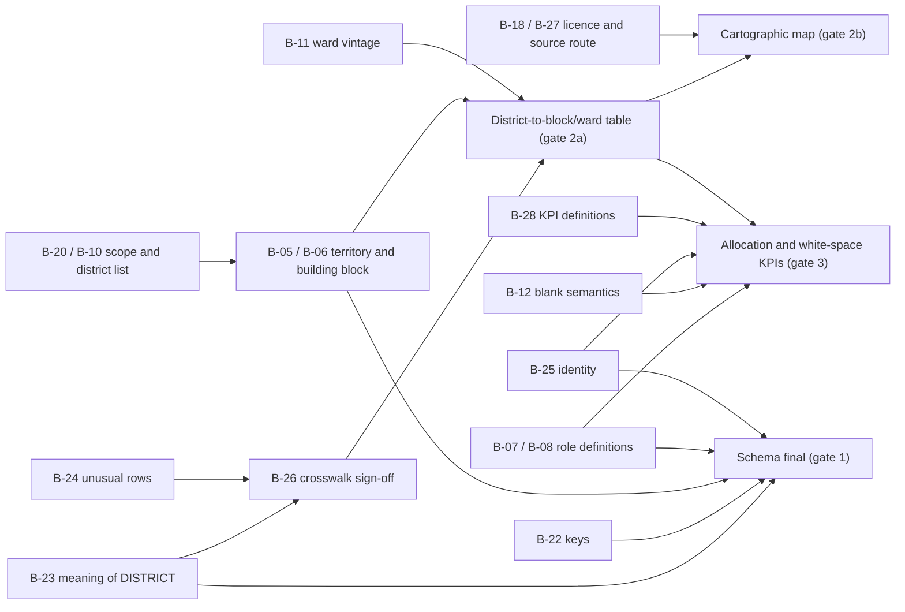

# Phase 0C: Decision brief and geographic feasibility

**Status: FOR STAKEHOLDER REVIEW. Nothing in this document is an approved decision.**
**Update 2026-10-15: four inputs from the project requester are recorded** (index in
section 1.5): a clarification for B-23 (section 2), a second clarification that the
blocks listed under each sales-territory label are that territory's intended membership
(R4, section 2; it also touches B-26, B-05, B-22, B-24 and B-20), a geographic-scope
preference for B-20 and B-10 (section 3) and an allocation-state rule for B-12 and B-28
(section 4). They are statements by the project requester. They are **not** formal
stakeholder or sponsor approvals, every formal approval stays outstanding (including
B-23 and the B-26 crosswalk sign-off), and the decision log (Appendix B) remains blank.
Prepared 2026-10-15. Builds on the five Phase 0B documents in this folder:
[workbook-inventory.md](workbook-inventory.md),
[data-quality-findings.md](data-quality-findings.md),
[geographic-data-assessment.md](geographic-data-assessment.md),
[proposed-data-model.md](proposed-data-model.md) and
[open-business-decisions.md](open-business-decisions.md).

This phase prepares decisions only. The workbook was not re-audited or modified,
no application code was written, and no boundary file was stored in the project.
No employee names, codes or pay data appear here; the workbook figures quoted are
counts taken from the Phase 0B documents.

## 0. How to read this brief

| Label | Meaning |
| --- | --- |
| **Verified (direct)** | Read or measured by this phase from the source itself. |
| **Reported** | Stated by a secondary source (news, summary, aggregator) and not confirmed against the primary text. |
| **Inference** | A reasonable reading that nobody has confirmed. |
| **Recommendation** | A proposed provisional default. **It is a proposal, not a fact and not a decision.** |
| **Unknown** | No evidence was found. |
| **Requester preference** | A preference stated by the project requester on 2026-10-15. It is a preference, **not formal business-sponsor approval**. |
| **Requester-confirmed evidence** | A fact about the source stated by the project requester on 2026-10-15. It has not been checked against a company document and is **not sponsor approval**. |

- **No formal stakeholder approval has been recorded or assumed.** The four requester
  inputs of 2026-10-15 (section 1.5) are recorded under the two requester labels above
  and complete no decision record. The project documents
  name no individuals, so "Suggested approver" gives a *role*. The sponsor must name
  the person. Where a role is a guess about who owns the topic, it says so. The
  documents do not name the requester or say whether they hold any approver role.
- **B-27 and B-28 are new in this phase.** They are not yet in
  [open-business-decisions.md](open-business-decisions.md), which was changed only
  for one factual correction (B-11; see section 1.4). *(As at Phase 0C. That register has
  since received requester notes dated 2026-10-15; B-27 and B-28 are still not rows in it.)*
- Question IDs (B-xx), finding IDs (DQ-xx, GEO-xx) and dependencies (G-xx) refer to
  the Phase 0B documents. Source IDs S1 to S16 are defined in
  [geographic-data-assessment.md](geographic-data-assessment.md); S17 onward are
  defined in section 6.3 of this brief.

---

## 1. Summary

### 1.1 Priority stack

Tier 1 decisions unlock the rest. Tier 2 are needed before the schema is final or
any map is built. Tier 3 can be approved as defaults or deferred (section 5).

| Tier | ID | Decision | Group | Recommended provisional default (short) | Suggested approver (role) |
| --- | --- | --- | --- | --- | --- |
| 1 | **B-23** | Is DISTRICT an administrative district or a sales grouping? | A, B | **Requester-confirmed evidence, 2026-10-15, adopted as the working interpretation (not an approval): DISTRICT is a sales territory or grouping, not necessarily an administrative district** (section 2). Keep label and official parent apart; **no direct join to district polygons**; no roll-up on the label; crosswalk still required. **R4 (2026-10-15, same status): the blocks listed under each label are that sales territory's intended membership and the starting input for the crosswalk** | Sales head or workbook owner. **Formal approval outstanding; not recorded** |
| 1 | **B-20, B-10** | Geographic scope (Kalimpong, Kolkata) and which district list | B | Scope = units the workbook represents; 23 notified districts as reference | Sales head (sponsor) |
| 1 | **B-07, B-08** | What Primary, Secondary and DSO mean; is DSO on distributor payroll | C | Seed no categories until defined; keep slot group as a source label | Sales head, HR head, distributor operations |
| 1 | **B-12** | What a blank cell means; what `Vacant` means | C | `Vacant` = vacancy candidate; blank = `unspecified`; never infer a vacancy | HR or position owner, sales operations |
| 1 | **B-25** | Identity: is there an HR ID; may names be imported; who confirms merges | C | Use an HR ID if one exists; otherwise names with identity `unconfirmed` | HR head with legal or privacy owner |
| 1 | **B-26** | Who signs the crosswalk from workbook labels to official units | B | One named reviewer signs, after a re-run on the official LGD export. *(R4: the workbook's listed rows are the membership input; the reviewer validates geography and flags conflicts, and does not decide membership. **Sign-off outstanding.**)* | Sales operations reviewer, data owner |
| 2 | B-05 | What is a "territory" | A | Each workbook row is a territory candidate. *(2026-10-15, R4: the working reading is a label-level sales territory whose listed rows are membership lines; see B-05. Not decided.)* | Sales head |
| 2 | B-06 | Building block per area type | B | Rural: block. Municipality: whole. Corporation: ward (whole unit until wards are mapped) | Sales head |
| 2 | B-24 | What the unusual rows are | B | Hold in a review queue; import none as geographic units or territories. *(R4: each row stays recorded as a listed membership line; only its geographic unit is held. No row is dropped.)* | Sales operations, data owner |
| 2 | B-22 | Stable keys for rows, positions, territories | A | Generated ID plus stored source row and file hash | Data owner, IT or data lead |
| 2 | B-09 | Several people per territory; dual roles; headcount rule | C | Allow both; count a person once | Sales head, HR head |
| 2 | B-21 | Meaning of `A / B` in the ASM cell | C | Two ASM assignments flagged `shared, unverified` | Sales operations for the 4 districts |
| 2 | **B-28** (new) | KPI definitions: allocation and white space | C | Per-category, tabular, with explicit denominators | Sales head (KPI owner) |
| 2 | B-19 | Phase 1 geographic depth | B | Tabular block-level first; map only after verified inputs | Sponsor |
| 2 | B-11 | Ward vintage for Kolkata and Howrah | B | Hold corporations as whole units until official boundaries are obtained | Sales head |
| 2 | B-18 | Legal approval of boundary data and map depiction | B | No boundary data enters the app until its licence row is signed | Legal or compliance owner |
| 2 | **B-27** (new) | Which boundary-source route to pursue | B | Tabular first; start the official-source requests in parallel | Sponsor, with legal and IT |
| 3 | B-13 | Allocation states and history depth | A | Planned, active, ended; full history; every change logged | Sales head, HR head |
| 3 | B-02, B-14, B-15, B-16, B-17 | Baseline confirmation, verified-coverage evidence, access, hosting, Power BI | D | See section 5 | See section 5 |

### 1.2 Dependency order

KPIs are tabular. They need the signed crosswalk (gate 2a) but **not** polygons
(gate 2b).

### 1.3 Geographic feasibility at a glance

Detail and evidence are in section 6.

| Level | Best identifier source | Best boundary candidate | Status |
| --- | --- | --- | --- |
| Codes and lists (state, district, block, urban body, ward) | LGD (official). Manual captcha exports; no CSV | None needed | **Feasible**, subject to written confirmation of commercial reuse (LGD's copyright policy permits free reproduction with acknowledgement but does not mention commercial use) |
| District polygons | LGD for codes | geoBoundaries ADM2: all 23 West Bengal districts found by name, **no codes in the file**, licence provenance link dead | **Feasible for a labelled prototype or roll-up of official districts.** Not verified as an official boundary. **The workbook's `DISTRICT` labels must not be joined to these polygons** (B-23 clarification, 2026-10-15) |
| Rural block polygons | LGD for codes | geoBoundaries ADM3 (2018): about 344 West Bengal features, some non-block units. Official route: Survey of India "up to taluk level" product, contents and terms not inspectable here | **Conditionally feasible, not verified.** No authoritative current block layer confirmed |
| Urban ward or borough polygons | LGD for ward lists | **None found.** Kolkata's ward count is changing (144 to 209) | **Not feasible yet** |
| Gram panchayat polygons | LGD for lists | None open found | **Not found** (and not needed unless GP-level territories are required) |

### 1.4 What this phase found that changes or adds to Phase 0B

1. **geoBoundaries contents were inspected, not just described.** ADM2 holds all 23
   notified districts including Kalimpong, Jhargram, Alipurduar and Paschim
   Barddhaman. Neither ADM2 nor ADM3 carries LGD codes.
2. **An India ADM3 (sub-district) layer exists** and was not assessed in Phase 0B.
   It is the only openly downloadable block-like layer found. It is 2018 vintage and
   unverified as authoritative.
3. **geoBoundaries' upstream provenance cannot be checked.** Its metadata cites
   `geonode.pathwaysdata.com` for both source and licence. That host did not resolve
   on 2026-10-15.
4. **Howrah "50 vs 66" is explained by primary text.** Two Gazette bills exist:
   Bill 4 of 2026 (5 Feb 2026) raises Howrah from 50 to **66**; Bill 18 of 2026
   (7 Aug 2026, "Second Amendment") raises it from 50 to **68**. Both quote the
   current statutory number as fifty. The Kolkata bill (Bill 19 of 2026) raises
   144 to 209.
5. **Kolkata's new ward schedule is reported as notified.** A secondary summary
   dated 2026-09-30 reports a notification substituting a new Schedule II that sets
   out 209 wards and their boundaries. The Gazette text was not retrievable, so
   this is **Reported**. Phase 0B said boundaries were "not yet drawn".
   [geographic-data-assessment.md](geographic-data-assessment.md) (GEO-03) and
   B-11 in [open-business-decisions.md](open-business-decisions.md) were corrected
   accordingly.
6. **LGD's copyright policy and terms were read.** Reproduction is free with
   acknowledgement; commercial use is not mentioned; accuracy is disclaimed.
7. **Survey of India route and undertakings were read.** They include
   no-sharing-with-foreign-entities and no-resale terms that interact with hosting
   (B-16) and licensing (B-18).
8. **Census-2011 sub-district polygons found are non-commercial** (CC BY-NC-SA 4.0)
   and not an official Census release.
9. **The West Bengal state geoportal (Basundhara) was unreachable** from this
   environment, and search results suggest access is for government departments.
10. **OpenStreetMap coverage of West Bengal blocks and wards is still unverified.**
    Every live query to public Overpass servers failed (HTTP 406, 500, 504).

### 1.5 Requester inputs recorded 2026-10-15 (index)

The project requester gave the four inputs below on 2026-10-15. Each is recorded where it
applies; this table is only an index. The documents do not name the requester, so none of
the inputs is recorded as the approval of a Head of Sales, the workbook owner, the sponsor
or any other designated stakeholder. **Every formal approval in the last column is
outstanding.**

| # | Input | Label | Recorded in | Formal approval (outstanding) |
| --- | --- | --- | --- | --- |
| R1 | Preferred map scope: **all of West Bengal**, including administrative areas the workbook does not represent (the requester's "Option A") | Requester preference | B-20 and B-10 (section 3); notes on B-11 and B-19 | B-20 and B-10 |
| R2 | Four allocation states stay distinct (Assigned, Vacant, Unallocated, Data Missing / Unknown). Missing data is never converted into Vacant or Unallocated. Coverage KPIs disclose denominator, data completeness and unknown areas | Requester preference | B-12 and B-28 (section 4); gates 1 and 3 | B-12 and B-28 |
| R3 | `AREA MAPPING.xlsx` is the company's official sales-team mapping workbook. Its `DISTRICT` column holds sales territories or groupings, not necessarily administrative districts | Requester-confirmed evidence | B-23 (section 2); notes on B-26 and B-19; gates 1 and 2a | B-23 and B-26. B-05 and B-02 are touched but not settled |
| R4 | The blocks listed beneath each sales-territory label in the workbook are the **intended membership** of that sales territory. The mappings may be used as the **authoritative business starting point** for the crosswalk. Refines R3 | Requester-confirmed evidence | B-23 (section 2, "Second clarification"); notes on B-26, B-05, B-22, B-24, B-20 and B-28; gates 1, 2a and 3 | B-23 and B-26 (crosswalk sign-off). B-05, B-24 and B-02 are touched but not settled |

"Option A" is the requester's label. This brief numbers its scope choices 1 to 3 and
defines no "Option A". The requester's description matches B-20 choice 2 (statewide) as
to the extent of the map.

---

## 2. Group A: Decisions that block the data model

These change the shape of the schema, not just its contents.

### B-23: Is DISTRICT an administrative district or a sales grouping?

#### Clarification recorded 2026-10-15, confirmed by the project requester

The project requester confirmed, on **2026-10-15**:

1. `AREA MAPPING.xlsx` is the company's official sales-team mapping workbook.
2. The workbook's `DISTRICT` column represents **sales territories or groupings**, not
   necessarily government administrative districts.

**Status.** This is **requester-confirmed evidence**, adopted as the working
interpretation of B-23 until a formal record exists. It is a requester statement only,
and it has not been checked against a company document. **No approval by a Head of
Sales, the workbook owner, the sponsor or any other formal stakeholder is recorded.** No
named approver, role or evidence link has been entered in the decision log (Appendix B).
**Formal approval of B-23 is outstanding** until the designated stakeholder records it.
Until then, this brief does not call B-23 an approved decision.

**What the working interpretation means** (until a formal record says otherwise):

1. **Every `DISTRICT` label is treated as a sales-territory label.** No label is assumed
   to be an administrative district, even where its spelling matches an official
   district name. "Not necessarily" allows that a label may coincide with an official
   district, but nothing recorded says which, so none is assumed to.
2. **The Excel `DISTRICT` column must not be directly joined to official administrative
   district polygons, names or codes**, whether by exact name, fuzzy name or the Phase 0B
   block-name overlap result. Such a join would silently assume what the requester says
   is not assumed.
3. **A reviewed crosswalk is still required** between the sales-territory labels (and the
   `BLOCK` labels listed under them) and actual geographic units: LGD-coded blocks,
   urban bodies and wards (B-26). The label is kept as `source_district_label`. The
   official parent of a unit comes only from the crosswalk and official data, never from
   the label.
4. **No block or ward membership is inferred.** This clarification does not say which
   blocks or wards belong to any sales territory. Membership is not to be inferred from
   official district boundaries, from name similarity, or from the Phase 0B overlap
   test. The workbook's row pairings (a `DISTRICT` label beside a `BLOCK` label) remain
   source data as written. Whether a pairing means "this block or ward belongs to this
   sales territory" is for the business to confirm in the crosswalk.
   *Update 2026-10-15 (R4, a later input the same day):* the requester has since
   confirmed that the blocks listed beneath each label **are** the intended membership of
   that sales territory (see "Second clarification" below). Membership is therefore taken
   from the workbook rows as written, and **nothing beyond those rows is inferred**. The
   bar on inferring membership from official boundaries, name similarity or the overlap
   test stands.
5. **No roll-up on the label as if it were a government district**, and no shading of
   district polygons from it. A roll-up by *official* district can only be built later,
   from crosswalked units, as a separate view.

**What it does not settle:**

- Whether any label coincides with an administrative district, and which.
- The definition, owner and master list of the sales territories; whether they carry
  codes (the workbook has none); how they change over time.
- Whether a block or ward may sit under two sales territories, and the double-counting
  rule. The six shared block labels, the two `Binpur` rows and the four Kolkata
  boroughs were read in Phase 0B as possible source errors. Under this interpretation
  they may be legitimate. **That is not confirmed either way**; it stays for crosswalk
  review (B-26) and B-24. *(Update, R4: the workbook lists each shared label under both
  territories and the requester treats the listed rows as intended membership. Both
  listings are kept as recorded membership and each is flagged for review. The
  double-counting rule is still undecided, and neither listing is dropped or resolved
  silently.)*
- Statement 1 says the file is the company's official sales-team mapping workbook. It
  does not say this copy is final or give an as-of date, so **B-02 stays partly open**.

**Knock-on effects (flagged, not decided here):**

- **B-05.** The default "each workbook row is a territory candidate" may need
  revisiting. If the sales territory is the `DISTRICT` label, a territory may be a
  grouping of rows rather than one row. *(R4 points that way; see B-05 below.)*
- **B-20 and B-10.** The absence of a Kalimpong or Kolkata *label* no longer shows that
  those areas are unrepresented, because their blocks could sit under a differently
  named sales territory. Whether they are represented can only be learned through the
  crosswalk. Scope stays open. The 21 labels are not an administrative district list, so
  B-10 concerns only the official reference list. See also the requester's scope
  preference in section 3 (B-20 and B-10).
- **B-22.** The composite key (label plus block label) now rests on a sales-territory
  label and can change if the business redraws territories.
- **B-19.** See the district roll-up row in section 3.
- **Schema.** A `SalesGrouping` entity (option B below) is supported as the working
  direction. Its code, owner and definition are unknown. *(Update: at the time of the
  first clarification [proposed-data-model.md](proposed-data-model.md) had not been
  changed. It now carries a "Clarifications recorded 2026-10-15" section, extended for
  R4, as a proposal. Its entity tables are preserved as originally written.)*
- `phase-0d-stakeholder-approval.md`, `phase-0d-geographic-source-gate.md` and the Phase
  0B documents (`workbook-inventory.md`, `data-quality-findings.md`,
  `geographic-data-assessment.md`, `proposed-data-model.md`) carry matching notes dated
  2026-10-15. The original Phase 0B findings in them are preserved as written. Where one
  reads the DISTRICT column as possibly administrative, read it together with this
  clarification. *(Update, R4: `phase-0d-stakeholder-approval.md`,
  `data-quality-findings.md`, `geographic-data-assessment.md`,
  `proposed-data-model.md` and `open-business-decisions.md` carry R4 notes.
  `workbook-inventory.md` and `phase-0d-geographic-source-gate.md` were **not** edited
  for R4. Their notes stay accurate, and their sentence that territory membership "is
  not inferred" is to be read with R4: membership is taken from the workbook rows as
  written, and nothing beyond them is inferred.)*

#### Second clarification recorded 2026-10-15 (R4): the blocks listed under a sales territory are its intended membership

The project requester confirmed, on **2026-10-15** (after the clarification above), that
the blocks listed beneath each sales-territory label in `data-source/AREA MAPPING.xlsx`
are considered the **intended membership** of that sales territory, and that these
mappings may be used as the **authoritative business starting point**.

**Status.** **Requester-confirmed evidence.** It records what the requester stated. It is
**not** formal approval by the Head of Sales, the sponsor, the workbook owner or any other
stakeholder, and no separate evidence of such an approval exists. It has not been checked
against a company document. It completes no decision record, and Appendix B stays blank.
**Formal approval of B-23 and sign-off of the B-26 crosswalk remain outstanding.**

**Reading of "beneath a label".** The rows that carry one `DISTRICT` value are contiguous
in the file (21 runs for 21 labels). A sales territory's listed membership is therefore
the set of `BLOCK` labels on the rows that carry its label. The workbook was **not
modified**. Its SHA-256 was re-checked read-only on 2026-10-15 and still matches the
baseline in [workbook-inventory.md](workbook-inventory.md). Only the two place columns (A
and B) were re-read for this update; no staff column was read.

**What is now treated as the authoritative business input**

| Authoritative as the business starting point | Not authoritative: needs independent evidence or a decision |
| --- | --- |
| For every row as written (358 rows, 21 territories): block label *B* is intended to belong to sales territory *T* | Which official geographic unit *B* is: LGD code, unit type, official parent |
| The 21 labels as the business's names for its sales territories | What a sales territory is: definition, owner, code, master list (B-23, B-05). The workbook has none |
| The starting input for the draft crosswalk (B-26) | Any boundary or geometry. The workbook contains none |
| | Whether a territory holds a whole block or only part of one. The statement lists blocks; no partial membership is assumed or inferred |
| | Any allocation state. Staff slots, blanks and `Vacant` are untouched by R4 (see below) |
| | The file's version or as-of date (B-02 stays partly open) |
| | Formal approval of anything |

**The crosswalk now has two layers, kept apart**

1. **Layer 1, membership (business input).** Each workbook row is one membership line: the
   sales-territory label and the block label **verbatim**, the workbook row number and the
   file hash. Lines are taken as written. Nobody adds, removes, merges, moves or
   "corrects" a line on inference. A suspected error goes back to the business as a change
   request and is recorded as one.
2. **Layer 2, geographic identity (independent validation).** Each block label is matched
   to an official unit (an LGD-coded block, urban body or ward) from independent official
   data, and later to a verified boundary (gate 2b). The sales-territory label is **never**
   used as an official district in that step: not to narrow the candidates, not to settle
   a tie, not to choose a spelling variant "in the same district". The Phase 0B counts
   (293 exact, 39 variants, 2 cross-district, 24 unmatched) were produced with exactly
   that constraint. They stay as diagnostics, and the test must be re-run without the
   constraint against a fresh official LGD export (G-09).

**Rules that follow** (from the requester's instruction)

1. The block labels listed under a sales territory are the intended business membership of it.
2. Those rows are the authoritative starting input for the crosswalk from sales territory to geographic unit.
3. The `DISTRICT` labels are **not** joined to official district names, codes or polygons.
4. Geographic identifiers and actual boundaries are matched and validated independently.
5. Unmatched, ambiguous, mixed-unit and conflicting records are flagged for review (table below). None is resolved silently.
6. The original rows and labels are preserved as source evidence. The workbook is not modified, no membership is inferred beyond the rows, and no row is dropped.
7. Requester confirmation is not formal approval.
8. The four allocation states stay separate (below).

**Records flagged for review.** The full list, with workbook row numbers, is in
[data-quality-findings.md](data-quality-findings.md) (DQ-15). Counts here are Phase 0B
counts or direct re-reads on 2026-10-15; the match-based ones are diagnostics that the
unconstrained re-run may change.

| Flag | Trigger | Known cases | Not resolved here because |
| --- | --- | --- | --- |
| **Conflict** | One block label listed under more than one sales territory | 6 labels, 12 rows: `Sankrail`, `Ausgram II`, `Joypur`, `Jangipara`, `Khanakul I`, `Khanakul II` | Whether one official block sits under two territories (overlap, double counting) or two places share a label is for the business and the unit-level match. Both listings are kept |
| **Mixed unit** | A label that may be an urban ward, borough, municipality or corporation, not a rural block | 12 rows: four `Borough` rows, `Behala municipality`, `Howrah MC`, `Durgapur Municipal Corporation`, `Asansol`, `Kulti`, `Bidhannagar Municipality`, `Chandanagar`, `Siliguri` | Classified from the label only. A KMC borough is not a ward, and a label does not give a unit type |
| **Unmatched or unclear** | No acceptable official match in the Phase 0B test | 24 rows (includes the 12 mixed-unit rows, 6 leftover pairings and 6 unclear rows such as `Galsi-W` and `Jharkhand-W`, which may be outside West Bengal) | The test was label-constrained and used a 2023 third-party mirror |
| **Spelling variant** | Matches an official name only after a spelling pairing | 39 variants (7 very close, 12 close, 20 weaker), plus `Binpur-I` and `Binpur-II`, which the mirror places in a different LGD district | Pairings were same-district constrained and stay unconfirmed |
| **Ambiguous name** | A spelling that could refer to more than one geographic unit | At least `Sankrail` (two official blocks and two boundary features of that name), `Joypur` (two differently spelled official blocks), `Faridpur Durgapur` beside `Durgapur Municipal Corporation`, `Galsi-W` beside `Galsi II`. The full set is known only after the unconstrained re-run | Choosing a candidate by the sales-territory label would use the label as a district |

**R4 and the four allocation states (R2).** Membership is not allocation.

- A block listed under a sales territory is **not** thereby **Assigned**. Assigned needs a
  valid, reviewed assignment (section 4). R4 supplies place membership, not a reviewed
  assignment of a person.
- A listed block with blank or whitespace-only staff slots is **Data Missing / Unknown**.
  The text `Vacant` stays a vacancy candidate until B-12 is decided.
- An official block that no listed row resolves to is "not listed in the workbook". It is
  not a member of any sales territory on the workbook's evidence, and its state is **Data
  Missing / Unknown**, never **Unallocated**, until evidence and approved rules say
  otherwise. Phase 0B counted 11 of 345 mirror blocks with no workbook counterpart (4 in
  Kalimpong); the set must be re-derived after validation.
- A block listed under two sales territories keeps both memberships. Its state is not
  decided by choosing one.
- **Confirmed Unallocated** needs evidence and approved business rules (B-28). R4
  supplies neither.

**Still outstanding after R4**

- *Formal approvals:* B-23 (decision-log record, `SalesGrouping` definition and owner);
  B-26 (named reviewer and sign-off); B-05 (territory definition); B-24 (the unusual
  rows); B-20 and B-10 (scope); B-12 and B-28 (allocation rules); B-02 (final version and
  as-of date). A written confirmation of R4 from the workbook owner would turn the
  requester statement into evidence the approver can cite.
- *Geographic validation:* the steps listed in
  [geographic-data-assessment.md](geographic-data-assessment.md) (GEO-08, clarification
  of 2026-10-15, item 5).
- *Review items:* every flagged record above.

**Reading note on the evidence below.** The Phase 0B statements that all 21 labels "map
to an LGD district by block-name overlap", and the row-count comparisons, are
diagnostics about how the block names under a label resemble an LGD district's block
list. They are **not** evidence that a label is that district, and they are **not** a
mapping to use. The original text is left as written.

**Question (original, Phase 0C).** Does the DISTRICT column hold the government
district, a company-defined sales district or cluster, or a mixture?

**Existing evidence**:

- All 21 labels map to an LGD district by block-name overlap (verified in Phase 0B).
  Nine labels differ in name from LGD (DQ-02), for example `Malda` / `Maldah`,
  `EAST BURDWAN` / `Purba Bardhaman`, and the abbreviation `DDP`.
- For 12 of 21 labels the row count equals the block count of the matching district
  in the 2023 mirror. For 9 it differs: Darjeeling, East Burdwan, Hooghly, Howrah,
  Jhargram, North 24 Parganas, South 24 Parganas, West Burdwan, West Midnapore.
  **Inference only:** rows also include urban units and the mirror is not
  authoritative, so a difference proves nothing alone.
- Six block labels appear under two workbook districts with different staff (DQ-05).
  Two are confirmed as two real places sharing a label; for four the mirror places
  the block in one district only.
- `Binpur I` and `II` sit under West Midnapore in the workbook but under Jhargram in
  the mirror. Four Kolkata boroughs sit under South 24 Parganas.
- There is no row for Kalimpong or Kolkata (DQ-03); the workbook uses 21 labels
  against 23 notified districts.

**Why it matters.** It decides whether district roll-ups, district polygons and any
statewide figure are valid, and whether the model needs a first-class sales-grouping
entity.

| Choice | Consequences |
| --- | --- |
| **A. Administrative district** | The overlaps and the 9 count differences are source errors to correct. District roll-ups become valid once corrected. No new entity. |
| **B. Sales grouping** | Add a `SalesGrouping` entity with its own code and owner. Official parent comes only from the crosswalk. Two roll-ups exist. A block under two groupings needs a double-counting rule. |
| **C. Mixed** | Decide per label in the crosswalk. Roll-ups are valid only for labels confirmed as administrative. |
| **Unanswered** | Label kept as `source_district_label`; no roll-up; district polygons shown only as unlabelled reference. |

**Which option the clarification points to (2026-10-15).** Option A is **not** the
working interpretation. The requester's wording ("sales territories or groupings, not
necessarily government administrative districts") matches option B. It does not rule out
that some labels coincide with an administrative district (option C). This brief does
not choose between B and C: the crosswalk review decides per label, and until it does,
every label is treated as a sales grouping.

**Recommended provisional default (recommendation, not fact).** Keep the
unanswered posture: store the source label and the official parent separately, allow
a nullable sales-grouping reference, and compute no district roll-up. Ask the owner
one question: *"Can a district in this sheet differ from the government district?"*
Attach the 21 labels, the 6 shared labels and the 9 count differences.

*Update 2026-10-15:* that posture now follows from the recorded working
interpretation rather than from the absence of an answer, and the question above is
largely answered. The remaining questions for the workbook owner are narrower:
*"Which sales territories, if any, coincide with a government district? Who owns the
list of sales territories and does it have codes? May a block or ward sit under two
sales territories?"* The 21 labels, the 6 shared labels and the 9 count differences are
still the right attachments, now as inputs to the crosswalk review.

*Update 2026-10-15 (R4):* the question about a block under two sales territories is now
concrete. The workbook already lists six block labels under two territories each (12
rows). The open point is the **double-counting rule**, and whether each pair is one
official block shared or two places that share a label. Attach the 12 rows
(data-quality-findings.md, DQ-15).

**Suggested approver.** Head of Sales or whoever maintains the workbook's district
groupings (role guessed; not recorded). **Formal approval is outstanding and not
recorded.**

**Blocked until approved.** Whether `SalesGrouping` exists in the schema; crosswalk
sign-off (B-26); every district-level roll-up or KPI; any district-polygon map.

*Update 2026-10-15:* the requester's clarification gives a working direction but is not
a formal approval. Still blocked: the formal decision-log record; crosswalk sign-off
(B-26); any roll-up by official district (needs the crosswalk); any district-polygon map
built from `DISTRICT` labels (not permitted under the working interpretation); and the
definition and owner of the sales groupings.

*Update 2026-10-15 (R4):* R4 lets the draft crosswalk **start from the workbook rows**. It
unblocks drafting, not sign-off. Everything listed as still blocked above stays blocked.

### B-05: What is a "territory"?

**Existing evidence.** No territory code exists. Each row is one block or urban unit
with staff slots (workbook-inventory section 2, inferred, unconfirmed). The
proposed model builds `Territory` as a named set of administrative units.

**Why it matters.** Decides whether `Territory` is imported or constructed, and
whether PIN codes are ever a unit (GEO-09).

| Choice | Consequences |
| --- | --- |
| **1. Each workbook row** | One territory per row, one unit member each. Matches the sheet. Codes must be generated. |
| **2. District** | Collapses 358 rows to the district level and loses block detail the business keeps. |
| **3. A named business object with its own code** | The business must supply the codes and list; the sheet cannot. |
| **4. PIN-coded area** | A separate unit type with overlap rules. PIN areas do not nest inside blocks or wards. |

**Recommended provisional default.** Choice 1: each row is a territory candidate.

**Suggested approver.** Head of Sales.

**Blocked until approved.** `Territory` and `TerritoryMembership` design; territory
code policy; PIN-code unit type.

*Update 2026-10-15 (R4).* The requester calls the `DISTRICT` value a sales-territory label
and the blocks beneath it that territory's intended membership. Read together, that
points to **a sales territory = a label, with its listed rows as membership lines**,
rather than "one row = one territory". This brief records that as the **working
reading**, not as a decision: the requester gave no territory definition, the workbook
has no territory code, and formal B-05 is still open. The default above (each row is a
territory candidate) assumed the row was the territory, so it is **superseded as the
working reading**. Whichever grain is chosen, the row-level membership lines are kept
unchanged, so the choice changes how rows are grouped, not what is recorded. Territory
codes, if any, must come from the business.

### B-22: What stable key identifies a row, a position and a territory?

**Existing evidence.** The sheet has no key (DQ-01). Within the current sheet a
(district label, block label) pair is unique: no block name repeats inside one
workbook district. Six labels repeat across districts, so the block label alone is
not unique.

**Why it matters.** Without a rule a re-import cannot tell an edited row from a new
one.

| Choice | Consequences |
| --- | --- |
| **1. Generated ID plus stored source row and file hash** | Robust, but each re-import needs a matching rule or diff. |
| **2. Natural composite key (district label plus block label)** | Works today. Breaks if labels are corrected or B-23 changes the meaning of the label. |
| **3. Business-issued territory and position codes** | Best long-term. They do not exist; the business would have to create them after the crosswalk is signed. |

**Recommended provisional default.** Choice 1 now. Consider choice 3 after the
crosswalk is approved.

**Suggested approver.** Data owner with the IT or data lead.

**Blocked until approved.** `ImportBatch`, `SourceRow` and identity columns on
`Position` and `Territory`; re-import behaviour.

*Update 2026-10-15 (R4).* A membership line is source evidence. Identify it by a generated
ID plus the stored source row number, the verbatim sales-territory and block labels, and
the file hash (choice 1). A key built from the labels alone is fragile twice over: a
label can change if the business redraws a territory, and the same block label already
occurs under two territories in six cases.

### B-13: Allocation states, history depth and audit detail

**Existing evidence.** None in the workbook (no dates, no states). The proposed
model uses planned, active, ended with effective dates and an append-only change log.

**Why it matters.** Fixes effective dating and the audit table. The proposed default
is a superset of simpler choices, so approval can be a single yes.

**Choices.** Full history (proposed), current state only (cannot be reversed later
without data loss), or full history with a retention limit.

**Recommended provisional default.** Planned, active, ended; full history; every
change logged with actor and reason. **Open sub-question (new):** a retention period
for ended assignments, because they hold employee data.

**Suggested approver.** Head of Sales, with HR for the retention rule.

**Blocked until approved.** Effective-dating columns and `ChangeLog` shape.

### Schema-affecting parts of decisions decided elsewhere in this brief

| Decision | What it fixes in the schema | Can the schema proceed on the default? |
| --- | --- | --- |
| B-25 | Whether `Person` carries an HR identifier column; whether names are stored at all | Only if the owner confirms whether an HR ID exists |
| B-07 | Allowed values of `payroll_kind` | Yes, with company and distributor |
| B-09 | Cardinality of assignments | Yes; the default is the permissive superset |
| B-12 | Whether a vacancy is created from `Vacant` only | Yes |
| B-21 | A `shared` flag on assignments | Yes |
| B-20 | A scope-status vocabulary on units | Yes, once the vocabulary is agreed |
| B-06 | Where the building-block rule is stored | Yes |
| B-15 | Whether access is scoped by region or reporting line, which may need a region attribute | Only once that scoping basis is stated |

---

## 3. Group B: Decisions that block geographic mapping

### B-20 and B-10: Geographic scope and which district list

**Question.** Are Kalimpong and Kolkata in scope, and which district list does the
business report on?

**Existing evidence**:

- No Kalimpong row. No Kolkata label; four KMC boroughs appear under South 24
  Parganas (DQ-03, B-20).
- The workbook has 21 labels. The 23 notified districts are the safe baseline (GEO-02).
- **Reported:** five more districts (Kolkata reorganisation, Basirhat, Sundarban,
  Jangipur, Arambagh) were announced in the 22 June 2026 budget. Searches on
  2026-10-15 found proposals and conflicting counts (27 or 28) and no notification.
- **Verified (direct):** the geoBoundaries ADM2 file lists all 23 notified districts
  for West Bengal and no proposed district (section 6.2.2). It predates every 2026
  proposal.

**Why it matters.** Scope sets the denominator of every coverage figure and whether
Kolkata wards (whose count is changing) or Kalimpong blocks are needed at all (G-10).

| Choice | Consequences |
| --- | --- |
| **1. Scope = units the workbook represents** | Kalimpong and Kolkata are `not represented`, never `unallocated`. No statewide claim. Smallest geography need. |
| **2. Statewide: all 23 notified districts** | Kalimpong and Kolkata are in scope with no staffing data, so they would show as white space. Drags Kolkata ward boundaries and B-11 into Phase 1. *(Qualified 2026-10-15: under the requester's allocation-state rule, an area with no allocation data is Data Missing / Unknown, not white space. See the requester preference below and section 4.)* |
| **3. Defined business regions** | Needs the business to list the units. Denominator is exactly that list. |
| District list: **23 notified now, proposed ones recorded as `proposed`** (recommended), or a later list | A later list needs a gazette notification and a succession mapping. |

**Recommended provisional default.** Choice 1, with a visible scope status on every
unit (`in scope, represented`, `in scope, not represented`, `out of scope`,
`unknown`). Use the 23 notified districts as the reference list.

#### Requester preference recorded 2026-10-15: all of West Bengal

The project requester stated, on **2026-10-15**, a preference that the map covers **all
of West Bengal**, including administrative areas that the current sales-mapping workbook
does not represent (the requester's "Option A"). Label: **requester preference**.

**Status.** This is a preference only. **It is not formal business-sponsor approval.** No
approval of B-20 or B-10 by the Head of Sales, the sponsor or any other designated
stakeholder is recorded, and the formal approval field stays **open**. The recommended
default above is a proposal and is not withdrawn: the requester's preference for the
map's extent is recorded alongside it, not in place of it. The 23 notified districts stay
the reference list.

**What it says.**

1. **Map extent.** The map is to cover the whole state, not only the units the workbook
   represents. This matches choice 2 above as to the extent of the map.
2. **Areas the workbook does not represent.** The audit found no row matching Kalimpong
   blocks and only four Kolkata boroughs (DQ-03). Because the `DISTRICT` labels are sales
   territories (section 2), the full list of areas the workbook does not represent is not
   yet known. It can only be learned through the reviewed crosswalk (B-26).

**What it does not settle.**

- **The KPI denominator.** This brief treated "scope" as one question. The preference
  answers the map's extent only. Which units form the denominator of a coverage figure is
  a separate decision, to be made with the coverage rules (B-28). Until then every figure
  must disclose its denominator (section 4).
- **Absence of staffing data.** Choice 2 above says Kalimpong and Kolkata "would show as
  white space". The requester's allocation-state rule qualifies that: an area with no
  allocation data is **Data Missing / Unknown**, never Unallocated or white space on that
  ground alone (section 4).
- **The district list (B-10).** Not addressed. The 23 notified districts remain the
  reference list and proposed districts stay `proposed`.
- **Map depth, source, licence.** B-19, B-27, B-18 and gate 2b are untouched. A statewide
  extent brings every West Bengal urban body into the boundary need, including the
  Kolkata (209) and Howrah (68) wards that exist only as text (B-11;
  [phase-0d-geographic-source-gate.md](phase-0d-geographic-source-gate.md), section 10).
  No polygon source passes gate 2b today.

**Suggested approver.** Head of Sales (scope); GIS or data lead (list vintage).

**Blocked until approved.** Denominators, scope flags, the LGD export scope (G-04),
and whether Kolkata ward work is needed.

*Update 2026-10-15 (R4).* Once the crosswalk is validated, the workbook's listed blocks
show which official units the business has put under a sales territory. That is evidence
about **what the workbook lists**, not a scope decision. Official units that no listed
row resolves to are "not listed in the workbook" and stay **Data Missing / Unknown**
(section 2, R4), not Unallocated. Phase 0B's four Kalimpong blocks with no workbook
counterpart are the known example, to be re-derived. Scope (B-20) and the KPI
denominator (B-28) are still decided by the approver, not by the crosswalk.

### B-24: What the unusual rows are

**Existing evidence.** 12 rows read as urban units (4 KMC boroughs, Behala, Howrah,
Durgapur, Asansol, Kulti, Bidhannagar, Chandannagar, Siliguri). 6 pair with a
leftover LGD block in the same district (for example `Medinipur Sadar`). 6 are
unclear, including `Galsi-W` and `Jharkhand-W`. `Jharkhand-W` is not a West Bengal
block name and may be out of state (DQ-04, DQ-07).

**Why it matters.** These rows may not be administrative blocks, and one may not be
in West Bengal.

| Choice (per row) | Consequences |
| --- | --- |
| **Assign a unit type and an official unit** | Row joins the crosswalk and hierarchy. |
| **Exclude from scope** | Removed from denominators; recorded as excluded with a reason. |
| **Hold in review** | Imported as source data only; no territory created. |

**Recommended provisional default.** Hold all 24 in review; create no territory
from them; flag `Jharkhand-W` as possibly out of state.

**Suggested approver.** Sales operations (who knows these areas) with the data owner.

**Blocked until approved.** Crosswalk completeness (B-26); the urban-unit rows of the
hierarchy.

*Update 2026-10-15 (R4).* The business lists these 24 rows under sales territories like
any other. They stay recorded as membership lines (source evidence) and are **never
dropped**. "Create no territory from them" in the default above means that **no resolved
geographic unit link is created until review**. It does not remove the row's listing. A
KMC `Borough` is not a ward, and a label that may be a ward, borough, municipality or
corporation is flagged as a mixed unit, not classified from its name. The 24 is a Phase
0B count from a label-constrained name test and may change on the unconstrained re-run.

### B-06: Building block per area type

**Question.** Below which unit are territories never split: district, CD block, ward,
whole municipality?

**Existing evidence.** The workbook's grain is block plus a few urban units; it goes
no lower (workbook-inventory section 4). Ward polygons for any in-scope urban body
were not found (section 6.2.4).

**Why it matters.** It defines "unallocated" and which boundary data is needed.

| Choice | Consequences |
| --- | --- |
| **Rural block; municipality whole; corporation ward** (Phase 0B default) | Correct target. Corporation wards need data that does not exist yet. |
| **Rural block; every urban body whole** | Buildable now. Hides ward-level allocation inside corporations. |
| **District** | Hides all block-level allocation the business records. |

**Recommended provisional default.** Keep the Phase 0B target rule, and **use the
whole urban body as the building block in Phase 1 wherever ward boundaries are not
verified.** The four KMC boroughs in the sheet are not wards; hold them as units
without geometry.

**Suggested approver.** Head of Sales.

**Blocked until approved.** The definition of "unallocated"; denominators; which
polygon layers are required.

### B-26: Who confirms the block-name crosswalk

**Question.** Who signs the mapping from workbook labels to official units?

**Existing evidence (GEO-08, DQ-07)**:

- Against a **2023 third-party mirror** (not authoritative; see section 6): 293 of 358
  rows match exactly after normalising case, spaces and dashes; 39 match as
  spelling variants (7 very close, 12 close, 20 weaker); 2 match a block the mirror
  places in another district; 24 are unmatched.
- Review workload: 63 rows (24 unmatched plus 39 variants) plus the 2
  cross-district rows. Of the 45 pairings, 6 are leftover inferences, not name
  matches. 21 district labels need one sign-off (9 differ from LGD spelling).
- geoBoundaries ADM3 has two features called `Sankrail` (Howrah and Jhargram), so a
  join on block name alone is unsafe even in official data.

**Why it matters.** Official codes cannot be assigned automatically (DQ-01). Every
join to geography, boundaries and KPIs rests on this file.

| Choice | Consequences |
| --- | --- |
| **One business reviewer signs every pairing and every unclear row** | Simple and accountable. Needs someone who knows the field geography. |
| **Auto-accept only exact-after-normalisation matches; review the rest** | Less work. The 293 exact matches are still unconfirmed names, so this is a reasoned shortcut, not proof. |
| **Two-person review for weaker pairings (the 20 weaker plus the 6 leftovers)** | Highest confidence; slowest. |

**Recommended provisional default.** One named reviewer signs a crosswalk file
(fields in Appendix B), **after** the name test is repeated against a fresh official
LGD export (G-09). A crosswalk signed against the 2023 mirror would have to be
re-reviewed. Drafting may start now; sign-off should not.

**Suggested approver.** A named sales-operations reviewer, with the data owner
accepting the file.

**Blocked until approved.** Gate 2a (the district-to-block table), and everything
after it: boundary joins and all KPIs.

*Update 2026-10-15 (B-23 clarification).* The crosswalk is **still required**, and its
job is wider than a name match. The 21 `DISTRICT` labels are sales-territory labels
(section 2, B-23). So the "21 district labels need one sign-off" item above is **not** a
spelling check against LGD district names. For each label and each `BLOCK` label under
it, the reviewer records which actual geographic unit it corresponds to, or that it is
excluded or held, using information supplied by the business. The reviewer must not
infer which blocks or wards belong to a sales territory from official district
boundaries or name similarity. The Phase 0B name-overlap test remains a diagnostic only.

*Update 2026-10-15 (R4).* Since the workbook rows are now the authoritative membership
input (section 2, "Second clarification"), the reviewer's job is **geographic
validation, not a membership decision**. For each row the reviewer: (1) records the
verbatim labels and the source row; (2) matches the block label to official units
without using the sales-territory label as a district, and records **every** candidate;
(3) assigns the unit type, LGD code and official parent from official data; and (4) sets
a review flag where the record is unmatched, ambiguous, mixed-unit or in conflict. The
reviewer does not add, remove, merge or move a membership line. A suspected error in
the workbook goes to the business as a change request. Every one of the 358 rows needs
this review: an exact-after-normalisation match against a **unique** official unit is a
candidate for fast review, but it is still unconfirmed, and an exact match to more than
one official unit is ambiguous. **No sign-off is recorded.**

*Update 2026-10-15 (requester preference, section 4).* A place name the crosswalk cannot
match is never classified as Unallocated or Vacant. The areas it might have covered stay
**Data Missing / Unknown** until the link is supplied.

### B-11: Ward vintage for Kolkata and Howrah

**Existing evidence (updated; see section 6.2.4)**:

- **Verified (direct):** Bill 19 of 2026 (Gazette, 7 Aug 2026) raises Kolkata from 144
  to 209 councillors. Bills 4 and 18 of 2026 raise Howrah from 50 to 66 and to 68
  respectively; both name 50 as the current figure. None of the three bills sets out
  boundaries.
- **Reported:** the Kolkata Schedule II with ward boundaries has been notified
  (secondary summary dated 2026-09-30); Howrah boundaries, Governor's assent and
  the Bally separation are unconfirmed. No downloadable polygon was found for any
  of the 144, 209, 50 or 68-ward geographies.

**Why it matters.** Ward-based allocation needs boundaries that either no longer
apply or do not exist as geometry yet.

| Choice | Consequences |
| --- | --- |
| **Old wards (144 and 50) with a validity end date** | Matches today's statute. Obsolete soon; needs a succession map. |
| **New wards (209 and 68) once boundaries exist** | Correct going forward. Needs the Schedule or polygons converted to a usable form. |
| **Whole corporation as one unit for now** | No ward data needed. No ward-level allocation. |

**Recommended provisional default.** Hold KMC and Howrah as whole units (or the four
boroughs in the sheet) until official boundaries are obtained and a vintage is
chosen. If Kolkata is out of scope under B-20, this does not block anything.

**Suggested approver.** Head of Sales.

**Blocked until approved.** Any ward-level hierarchy or map for Kolkata or Howrah.

*Update 2026-10-15 (requester preference, section 3).* The requester prefers a map of all
of West Bengal, which includes Kolkata and Howrah. The closing condition above ("if
Kolkata is out of scope under B-20, this does not block anything") therefore cannot be
relied on for the map unless the formal B-20 decision says so. The interim hold on whole
units stays. No approval is recorded.

### B-19: How deep must Phase 1 go geographically

**Existing evidence.** Allocation is recorded per block, so a district-only map
would hide it. District polygons are obtainable (section 6.2.2). Block polygons are
a conditional candidate (6.2.3). Urban ward polygons are not available (6.2.4).

| Choice | Consequences |
| --- | --- |
| **Tabular, block level, no map** | Buildable now. No polygon licence risk. |
| **District roll-up map** | Buildable for a labelled prototype. **Valid only after B-23** is answered. *Update 2026-10-15:* under the working interpretation, a roll-up by the workbook's `DISTRICT` label onto official district polygons is **not valid**. A roll-up by *official* district needs the reviewed crosswalk (B-26) first. |
| **Block map** | Needs gate 2b: a verified block layer, licence determination, code join. |
| **Block and ward map** | Not feasible yet. |

**Recommended provisional default.** Tabular block-level allocation first. A
district roll-up map only after B-23 is formally decided and the roll-up by *official*
district can be built from the reviewed crosswalk (B-26). It is never built from the
workbook's `DISTRICT` labels. A block map only after gate 2b.

**Suggested approver.** Sponsor.

**Blocked until approved.** Phase 1 scope, and therefore gate 4.

*Update 2026-10-15 (requester preference, section 3).* The preference for a map of all of
West Bengal concerns the map's *extent*, not its depth. B-19 stays open. A statewide
extent does not make any polygon source pass gate 2b.

### B-18: Legal approval of boundary data and map depiction (with G-06, G-07)

**Existing evidence (section 6.4)**:

- ODbL 1.0 was read directly: commercial use is allowed; internal use of a
  derivative database is not "public"; a map shown publicly needs a notice; a
  derivative database used publicly must stay under ODbL or a compatible licence.
- LGD: copyright policy allows free reproduction with acknowledgement; commercial
  use not mentioned. Not an open-data licence.
- Survey of India checkout undertakings (S17): comply with the 2021 Guidelines; do
  not share with any foreign individual or entity except as law permits; do not sell
  the product; attribute the Survey.
- DST 2021 Guidelines page (S18): Survey of India digital boundary data "shall be
  used as a standard for publishing political Maps of India of any scale". The page
  is titled for foreign entities; whether it binds a domestic company is **Unknown**.
- **Inference:** distributors' own staff viewing territory maps may count as use
  outside the company under ODbL, and a foreign-operated hosted database may count
  as sharing with a foreign entity under the Survey undertaking. Both are questions
  for legal, not conclusions.

**Choices.** Per boundary source: approve for internal use only; require written
confirmation from the licensor first; or accept only sources with an explicit open
licence.

**Recommended provisional default.** No boundary dataset enters the repository or
application until its row in section 6.4 carries a written legal determination.

**Suggested approver.** Legal or compliance owner (role guessed).

**Blocked until approved.** Gate 2b; any use of third-party boundaries; any shared,
embedded or Power BI map.

### B-27 (new): Which boundary-source route to pursue

**Question.** Which way will the company obtain block and ward boundaries, and who
is authorised to approach the sources?

**Existing evidence.** No authoritative, current, openly licensed block or ward layer
was confirmed. Candidates and their gaps are in section 6.

| Choice | Consequences |
| --- | --- |
| **a. Prototype on geoBoundaries ADM2 and ADM3** | Fastest. Unofficial, 2021 and 2018 vintages, dead provenance link, no codes. Label as indicative. |
| **b. Official route** (Survey of India product on a company account; State bodies for ward boundaries; LGD for codes) | Authoritative in principle. Contents, terms and prices unverified; needs accounts, letters and time. |
| **c. Digitise from gazetted descriptions** | Authoritative text, high effort, needs GIS skills. |
| **d. No polygons in Phase 1** | No licence or source risk. No map. |

**Recommended provisional default.** Choice d for Phase 1, with choice b started in
parallel. Choice a only for an internal, labelled-indicative prototype after B-18.

**Suggested approver.** Sponsor, with legal (B-18) and IT (accounts and hosting).

**Blocked until approved.** Starting any source request; gate 2b.

---

## 4. Group C: Decisions that block employee classification and coverage calculations

### B-08 and B-07: What Primary, Secondary and DSO mean; is DSO on distributor payroll

**Existing evidence.** The file defines no role term. `DSO` is not expanded
anywhere. There is no payroll-type column (DQ-13). PRIMARY, SECONDARY and DSO are
three groups of slots per row: 395, 429 and 104 populated slots; 67, 100 and 44
distinct names. **Inference only:** common sales usage reads primary as
company-to-distributor and secondary as distributor-to-retailer. Do not assume it.

**Why it matters.** It seeds the responsibility categories and every headcount and
coverage figure by role.

| Choice | Consequences |
| --- | --- |
| **1. Business supplies written definitions** (Appendix B template) | Categories and headcount follow the definitions. |
| **2. Industry-standard reading adopted explicitly** | Fast, but the business must sign it as its own definition. |
| **3. No categories; slot group kept as a source label** | Nothing is wrongly classified. No role-based KPI. |
| **DSO on company payroll** | DSO staff count in company headcount. |
| **DSO on distributor payroll** | Excluded from company headcount; reported separately; `payroll_kind = distributor`. |

**Recommended provisional default.** Choice 3 until the business answers. Store
`slot_group` as a source value with no semantics, and report by source name only.

**Suggested approver.** Head of Sales (definitions); HR head (payroll status);
distributor operations or trade marketing (DSO), roles guessed.

**Blocked until approved.** Responsibility-category seed data; any headcount or
coverage figure by role; the company-versus-distributor headcount split.

### B-12: What a blank cell means; what `Vacant` means

**Existing evidence (DQ-09, DQ-12).** `Vacant` appears in 30 cells across 22 rows
(PRIMARY 13, SECONDARY 17). Blank is common and differs by column group: first
PRIMARY slot blank in 72 of 358 rows, first SECONDARY in 51, first DSO in 267. 26
cells are whitespace-only and look blank. 24 rows have no PRIMARY and no SECONDARY.
There is no position ID or approval reference.

**Inference.** The different blank rates by group are consistent with different
meanings per group (for example DSO being optional), but this is unconfirmed.

**Why it matters.** It separates a vacancy from missing data, and decides whether the
24 rows are white space.

| Choice | Consequences |
| --- | --- |
| **Blank = not applicable** | Row not counted as a gap. White-space KPI shrinks. |
| **Blank = unfilled seat** | Every blank slot counts as a vacancy. About 3,000 blank slot cells (columns D to N, including the 26 whitespace-only ones) would become vacancies, mostly unused slot capacity. |
| **Blank = not recorded** | Treated as unknown. KPIs carry an "unknown" share. |
| **Different per column group** | The business fills the matrix in Appendix B. Most accurate. |
| **`Vacant` = approved open position** | Needs a position ID or approval reference, which the file lacks. |

**Recommended provisional default.** `Vacant` = vacancy candidate; blank and
whitespace-only = `unspecified`; never infer a vacancy from blank; show the 24 rows
as "no operational staff recorded", not as gaps.

**Suggested approver.** HR or whoever approves positions; sales operations for the
per-column meaning.

**Blocked until approved.** Vacancy KPIs, white-space KPIs, and creation of
`Position` records from slots.

#### Requester preference recorded 2026-10-15: missing data is never Vacant

The requester's allocation-state rule (recorded under B-28 below) applies here directly.
Under it, a blank or whitespace-only Excel cell, an unmatched place name and an absent
employee record are **never automatically classified as Vacant or Unallocated**. Their
state is **Data Missing / Unknown**. This agrees with the recommended default above.
**Status: requester preference, not an approval. B-12 stays open**, and no approver,
role or evidence link is recorded. Two points are left for the approver:

1. The literal text `Vacant` stays a *vacancy candidate*. It is not counted as the state
   **Vacant** (an approved position known to be vacant) until B-12 says what evidences an
   approved position.
2. The 24 rows with no PRIMARY and no SECONDARY are shown as "no operational staff
   recorded". In those slot groups their allocation state is Data Missing / Unknown
   unless evidence establishes another state. They are not Unallocated.

### B-25 (with B-03): Identity, and whether names may be imported

**Existing evidence (DQ-06, DQ-14).** Names only: 225 distinct normalised name
strings. 3 near-duplicate pairs (similarity 0.88 to 0.92). 2 names in more than one
raw spelling. 3 with stray whitespace. 5 single-word names. 6 names in more than one
role group; 16 in more than one district. No employee identifier exists in the file.
Whether one exists elsewhere is **Unknown**.

**Why it matters.** Headcount and dual-role analysis rest on identity. Importing
employee names is also a privacy question: its applicability under India's Digital
Personal Data Protection Act, 2023 was **not researched** in this phase and is a legal
question.

| Choice | Consequences |
| --- | --- |
| **1. An HR or distributor ID exists and is imported** | Exact identity. Best headcount. Needs a join source and permission. |
| **2. Names only, identity `unconfirmed`, merges reviewed** | Works now. Headcount is "distinct names, unconfirmed" with an unknown error band. |
| **3. Do not import names; pseudonymous IDs with a manual map** | Lowest privacy exposure. Much more manual work; users cannot read names. |

**Recommended provisional default.** Choice 1 if an ID exists; otherwise choice 2,
only after HR and legal confirm names may be imported. Report headcount as
"distinct names, unconfirmed" until merges are signed.

**Suggested approver.** HR head, with legal or the data-protection owner. Merge
sign-off by a person who knows the field staff.

**Blocked until approved.** The `Person` identifier column, the import allow-list
(B-03), headcount KPIs, and dual-role counts.

### B-09: Several people per territory; dual roles; headcount rule

**Existing evidence.** 96 rows list two or more PRIMARY names and 96 two or more
SECONDARY. 16 names appear in more than one district and 6 in more than one role
group (name matches only).

| Choice | Consequences |
| --- | --- |
| **Allow many-to-many; count each person once** | Matches the sheet. Needs separate "headcount" and "assignment" counts. |
| **One owner per territory per category** | Contradicts the data: 96 rows would be rejected or reduced. |
| **One territory per person** | Contradicts the 16 multi-district names. |

**Recommended provisional default.** Allow both. Headcount counts a person once;
coverage counts each assignment once; an optional `lead` or `shared` flag.

**Suggested approver.** Head of Sales and HR head.

**Blocked until approved.** The assignment constraint and the headcount rule used in
every KPI.

### B-21: What `A / B` in the ASM cell means

**Existing evidence.** 37 rows in four districts (Alipurduar, Coochbehar, Darjeeling,
Jalpaiguri) hold two ASM names; the same pair appears on every row of that district
(DQ-11).

| Choice | Consequences |
| --- | --- |
| **Joint responsibility** | Both assigned to every row; flagged shared. |
| **Area split** | Needs the split by block, which the sheet does not give. |
| **Handover** | One assignment should be ended with a date; dates are unknown. |

**Recommended provisional default.** Two ASM assignments per row flagged
`shared, unverified`; neither treated as ended.

**Suggested approver.** Sales operations owner for those four districts.

**Blocked until approved.** ASM assignment storage and ASM counts for 37 rows.

### B-28 (new): What the allocation and white-space KPIs mean

**Question.** How are "allocation" and "white space" defined, and over which
denominator?

**Existing evidence.** The proposed model keeps four concepts apart: assigned,
vacant approved position, unallocated, verified ground coverage
([proposed-data-model.md](proposed-data-model.md)). "White space" is not defined in
any document. B-20, B-06, B-08, B-12 and B-23 each change the answer.

| White-space definition | Consequences |
| --- | --- |
| **W1. Building block with no active assignment of any kind** | Simple; hides category gaps. |
| **W2. No active assignment in category X** | Needs B-08 definitions; per-category. |
| **W3. Only vacancies assigned** (no filled seat) | Needs B-12; separates "nobody there" from "seat empty". |
| **W4. No verified ground coverage** | Needs B-14 evidence rules. Not buildable in Phase 1. |

**Recommended provisional default.** Report W2 and W3 separately, per category, as
tabular figures labelled by source slot group. Show "no operational staff recorded"
as its own bucket. State the denominator on every figure (in-scope building blocks
under B-20 and B-06). Never use W4 until B-14 is decided. Use the word "assigned",
not "covered".

**Suggested approver.** Head of Sales as KPI owner.

**Blocked until approved.** Gate 3.

#### Requester preference recorded 2026-10-15: four allocation states and KPI disclosure

The project requester stated the rules below on **2026-10-15**. Label: **requester
preference**. **It is not formal business-sponsor approval.** B-28 and B-12 are not
approved, and no approver, role or evidence link is recorded for either. B-28 is not one
of the six decisions in the Phase 0D approval package, so it has no decision sheet and
no assigned approver yet.

**The four states.** They describe the allocation status of an area or position. They
are different from the assignment lifecycle states in B-13 (planned, active, ended) and
from the scope status in B-20 (`in scope, represented` and so on), which only says
whether the workbook contains the unit.

| State | Requester's definition |
| --- | --- |
| **Assigned** | A valid, reviewed assignment exists. |
| **Vacant** | An approved position is known to be vacant. |
| **Unallocated** | Evidence and approved business rules establish that no assignment covers the area. |
| **Data Missing / Unknown** | Allocation evidence is absent, incomplete, ambiguous or not yet verified. |

**The rule.** Missing data, an empty Excel cell, an unmatched place name or an absent
employee record is **never automatically classified as Unallocated or Vacant.**
**Inference:** by the definitions above, such a case is Data Missing / Unknown until
evidence for another state exists. This last step is a reading of the rule, not a
separate statement by the requester.

**KPI rules** (the requester's words, summarised):

1. The geographic map covers all of West Bengal (section 3, requester preference).
2. Every coverage KPI discloses its **denominator**, its **data completeness** and its
   **unknown areas**.
3. No definitive Unallocated percentage is calculated until the coverage rules and the
   required data have been approved.

**Not yet defined** (for the approver): what makes an assignment "valid" and "reviewed";
what evidences an approved position (B-12); the coverage rules for Unallocated,
including the building block (B-06) and the denominator (B-20); how data completeness
is measured; and which data counts as "required".

**Effects on this brief.**

- W1 and W2 above read the absence of an active assignment as white space. They cannot be
  applied as written to units whose state is Data Missing / Unknown. Whether and how
  they apply is part of this decision. W3 needs the Vacant state, which needs B-12.
- Any figure calculated before approval is a dry run and non-reportable (gate 3), and
  discloses its denominator, data completeness and Data Missing / Unknown areas.
- **Membership is not an allocation state (R4).** A block's listing under a sales
  territory does not make it Assigned, Vacant or Unallocated. A block listed under two
  territories keeps both memberships, and a figure that uses it discloses the overlap.
  An official block not listed in the workbook is Data Missing / Unknown. See section 2,
  "R4 and the four allocation states".
- The words "assigned" and "covered" stay apart (B-14). Verified ground coverage is not
  one of the four states.
- **Names in other documents.** [proposed-data-model.md](proposed-data-model.md) uses
  longer names for the same states: "Vacant" is **Vacant approved position**,
  "Unallocated" is **Confirmed unallocated**, and "Data Missing / Unknown" is **Data
  missing or unknown**. The requester's wording in the table above governs what each
  state means.
- That document's original "The four concepts, kept apart" table derives Unallocated as
  a building block covered by no active or planned assignment. Under the requester's
  rule, the absence of an assignment is not enough. The document has since been updated
  with a "Clarifications recorded 2026-10-15" section and an "Allocation states" table
  that add an explicit Data missing or unknown state and make Unallocated depend on a
  stored confirmation. That is a **proposal for the model**, not an approval: which role
  may confirm, and what evidence suffices, stay open under B-28, B-12 and B-14.

---

## 5. Group D: Decisions that can safely wait until a later phase

"Latest safe point" is the last moment the decision can wait. Phase 1 scope is not
yet defined, so some points are stated relative to it.

| ID | Decision | Why it can wait | Latest safe point | Guardrail until then |
| --- | --- | --- | --- | --- |
| B-14 | What counts as verified ground coverage | `CoverageVerification` stays empty by design (GEO-05) | Before any KPI is named "coverage" | Use "assigned", never "covered" or "served" |
| B-17 | Power BI relation to the app | Nothing is built | Before the analytics phase | None |
| B-15 | Who may view and edit; regional visibility | Not needed for schema except the scoping basis (section 2) | Before any authentication work in Phase 1 | No multi-user access |
| B-16 | Is a hosted database such as Supabase acceptable | The logical schema is portable | Before a database holding employee data is provisioned | No hosted database with employee data. Legal to read the Survey of India foreign-entity undertaking alongside it |
| B-02 | Confirm the file is final and its as-of date | The hash is recorded as baseline | Before the first import | Baseline = recorded hash |
| B-04, B-01 | Salary out of scope; workbook located | **Answered** in Phase 0B | n/a | n/a |
| B-03 | Allow-list of imported fields | Names part moved to B-25 | Before import design | Places and role slots only |
| Retention | Retention period for ended assignments | Soft-delete covers it | Before production use | Keep everything |
| G-03 | Gram panchayat polygons | Not needed unless GP-level territories | Only if B-06 goes below block | n/a |
| GEO-09 | PIN codes as a unit | Not adopted without B-05 saying so | Only if B-05 choice 4 | n/a |
| G-05 | Newly proposed districts, new wards | Recorded as `proposed` | When notified | Model status and succession |

---

## 6. Geographic data-source feasibility

Research date for everything below: **2026-10-15**.

### 6.1 Method, inspection levels and limits

| Level | Meaning |
| --- | --- |
| **Contents inspected** | The file was downloaded to a scratch folder **outside the project** and its contents parsed. |
| **Page read** | The page was fetched and read. |
| **Indirect** | A search-result snippet, or relayed by a third party. |
| **Unreachable** | The attempt failed. |

**Limits.**

- Web pages were read through a fetch tool that returns an *extraction* of the page,
  not raw HTML. Wording reported as a quotation comes from that extraction. **A
  person should re-read every licence text at its source before relying on it.**
- Only the **simplified** geoBoundaries files were inspected (suitable for counts
  and attributes, not for boundary accuracy).
- Nothing was downloaded into the project. Inspected files are listed in Appendix A
  with SHA-256 hashes.
- No workbook data were used for the geographic tests in this phase.

### 6.2 Findings by administrative level

#### 6.2.1 Identifiers and lists: Local Government Directory (S7)

| | |
| --- | --- |
| **Verified (direct)** | The download page offers about 60 entity types: states, districts, sub-districts, villages, **development blocks (with covered villages and village-to-block mappings)**, PRI, urban and traditional local bodies, **wards and localities of urban local bodies**, constituency mappings and pincode mappings. Options include "Download Directory (one entity at a time)", "Download All Entities of State" and "**Download Only Modifications**". Formats: PDF, HTML, XLS, ODT. A captcha is required. The page marks From and To dates as required (purpose not established). No "as on" date is shown. |
| **Verified (direct)** | The LGD home page shows a most recent logged modification stamped 2026-10-14 19:43:23 and states "Mandatory upload of Govt. order for each modification in the directory." This supports that the directory is current and is derived from State orders. |
| **Verified (direct)** | Web services are advertised through NAPIX (`dev.napix.gov.in/nic/lgd/`) with a "Report on consumers of web services". The service itself was not inspected; access terms are **Unknown**. |
| **Licence (page read)** | The Copyright Policy says material "may be reproduced free of charge in any format or media without requiring specific permission", subject to accurate reproduction, no derogatory or misleading use, and prominent acknowledgement of the source. **It does not mention commercial use.** The Terms and Conditions disclaim accuracy, say the content is not a statement of law or for legal purposes, and advise users to verify with State departments. **No open-data licence is stated.** |
| **Unreachable** | The data.gov.in mirrors of LGD (S7b) and the GODL text on data.gov.in returned HTTP 403, so any licence tagging there is unverified. |
| **Limitations** | Manual, one request at a time, no CSV, no geometry. Vintage must be recorded as the download timestamp plus the modifications log. Whether West Bengal's CD blocks sit under LGD's "development blocks" list, its "sub-districts" list, or both was **not established**. |
| **Verdict** | **Feasible** as the identifier and name authority. Obtain written confirmation of commercial reuse, and repeat the name test on a fresh export (G-04, G-09). |

#### 6.2.2 District boundaries

**geoBoundaries India ADM2 (S8)**:

| | |
| --- | --- |
| **Metadata (page read)** | `boundaryYearRepresented` 2021; `boundaryCanonical` District; `admUnitCount` 736; `sourceDataUpdateDate` 19 Jan 2023; `buildDate` 12 Dec 2023; `boundarySource` "Pathways Data Pvt. Ltd., lgdirectory.gov.in"; `boundaryLicense` "Open Data Commons Open Database License 1.0"; `licenseSource` and `boundarySourceURL` both `geonode.pathwaysdata.com/layers/geonode`. |
| **Contents inspected** | The simplified GeoJSON has **735** features (metadata says 736). Properties are `shapeName`, `shapeISO` (empty in the sample record), `shapeID`, `shapeGroup`, `shapeType`: **no LGD or Census code**. CRS is WGS84 (CRS84). Polygon and MultiPolygon only. |
| **West Bengal** | **All 23 notified districts are present by name**: Kalimpong, Darjiling, Jalpaiguri, Alipurduar, Koch Bihar, Uttar Dinajpur, Dakshin Dinajpur, Maldah, Murshidabad, Birbhum, Paschim Barddhaman, Barddhaman, Nadia, Puruliya, Bankura, Hugli, North Twenty Four Parganas, Kolkata, Haora, Paschim Medinipur, Jhargram, Purba Medinipur, South Twenty Four Parganas. `Barddhaman` is read as Purba Bardhaman (**Inference**). Spellings differ from LGD, so a name crosswalk to codes is still needed. |
| **Provenance gap** | `geonode.pathwaysdata.com` returned "ENOTFOUND" (the host does not resolve). The licence source and the original publisher's terms therefore **cannot be checked**. LGD offers no geometry download, so how Pathways produced the polygons is **Unknown**. |
| **Not found in the file** | Any of the proposed 2026 districts. Consistent with its 2021 vintage. |
| **Verdict** | **Feasible for a labelled prototype or roll-up of official districts.** Not verified as an official boundary. Licence provenance unresolved (B-18). **Not to be joined to the workbook's `DISTRICT` labels**, which are sales territories (B-23 clarification, 2026-10-15). |

Other district-level candidates (from Phase 0B, not re-inspected): DataMeet (vintage
not stated, "many errors"), GADM (commercial use barred; ruled out), Census 2011
(19 districts; obsolete).

#### 6.2.3 Rural block boundaries

This is the critical gap (G-01).

**geoBoundaries India ADM3, "Sub-District" (S8)**:

| | |
| --- | --- |
| **Metadata (page read)** | `boundaryYearRepresented` **2018**; `admUnitCount` 6,836; same source, licence and licence-source fields as ADM2. |
| **Contents inspected** | The simplified GeoJSON has **6,822** features (metadata says 6,836). Same five properties as ADM2, **no state attribute and no code.** A state filter is therefore only possible spatially. |
| **West Bengal result** | Using the 23 West Bengal district polygons from ADM2, **344 features** fall within them (a feature counts if at least 60 percent of sampled boundary points lie inside; method and per-district counts are in Appendix A). 22 features near state borders were ambiguous; two of them, Kharibari and Darjeeling Pulbazar, are probably West Bengal blocks by name (**Inference**). The true count is therefore about 344 to 346. |
| **What the features look like** | Names follow a block pattern (for example `Amta - I`) with mixed case and hyphen spacing (`Amta - Ii`, `Kalimpong -I`), so normalisation is needed. Two features are named `Sankrail` (Howrah and Jhargram). One feature is named `Kolkata`; **there are no ward or borough features.** Paschim Barddhaman has 9 features including `Asansol`, which looks like an urban unit (**Inference**). |
| **Comparison (information only)** | Against the 2023 mirror's counts by district, 16 of 22 districts agree and 6 differ by one or two: Jalpaiguri, Barddhaman, Birbhum, Paschim Barddhaman, Kalimpong, North 24 Parganas. (Darjiling agrees only when its two border features are counted, and South 24 Parganas only when the `Kolkata` feature is counted.) The mirror is non-authoritative, so this shows vintage and definition differences, not which layer is right. |
| **Not established** | Whether ADM3 "sub-district" equals LGD's block or LGD's sub-district for West Bengal; whether the 2018 set matches current blocks; geometry accuracy. |
| **Verdict** | **Candidate, not verified.** Usable only as an indicative prototype layer, after B-18, and only joined through a reviewed crosswalk. |

**Official and other routes**:

| Source | What was found | Status |
| --- | --- | --- |
| **Survey of India Online Maps (S17)** | The About page lists an "Administrative Boundary Database" covering "state, district, sub-district boundaries along with their head quarters" with products "up to taluk level" for the country or a state, plus a village boundary database. **Not stated:** price or free status, format, scale, vintage. Only the Open Series Map PDF is labelled free. The cart page shows the undertakings listed in 6.4. | **Best official route. Contents and terms of the actual files are unverified.** Whether "taluk" equals a West Bengal CD block is **Unknown**. |
| **West Bengal geoportal "Basundhara" (S27)** | Connection refused from this environment. Search results describe it as listing administrative boundaries with WMS and WFS, and suggest registration is by official letter for government departments (**Indirect**). | **Unreachable.** Treat as a lead to approach through the State; public access unlikely. |
| **Census 2011 sub-district polygons (S21)** | No official Census release found. The AIKosh listing (Development Data Lab) states **CC BY-NC-SA 4.0**, "compiled from various open-source geospatial datasets", and "some measurement inconsistencies may exist". | **Not usable commercially** without permission. 2011 vintage. |
| **ML InfoMap (Princeton, Columbia)** | Restricted to affiliated users; in copyright (**Indirect**). | **Not usable.** |
| **OpenStreetMap (S11, S28)** | ODbL. Coverage of West Bengal blocks and wards **not measured**: all eight live Overpass attempts across three public servers failed (HTTP 406, 500, 504). | **Unverified.** Retry from another network. |
| **Banglarbhumi mouza maps** | Images, no bulk vector download (Phase 0B). | Not usable as an administrative layer. |

#### 6.2.4 Urban ward and borough boundaries

| | |
| --- | --- |
| **Verified (direct, Gazette text via PRS, S22)** | **Bill 19 of 2026** (Kolkata Gazette Extraordinary, 7 Aug 2026), Kolkata Municipal Corporation (Amendment): in section 5, substitutes "two hundred and nine" for "one hundred and forty-four" Councillors; commencement by State notification; **no boundaries in the bill**. **Bill 4 of 2026** (Gazette 5 Feb 2026), Howrah: 50 to **66** "as decided by the State Government". **Bill 18 of 2026** (Gazette 7 Aug 2026, "Second Amendment"): 50 to **68**. All three give the current Howrah or Kolkata figure as the statutory number. Whether Bill 4 was overtaken by Bill 18 is **Unknown**. All three PDFs carry a line "As passed by the Assembly on the 27th February, 2018", which cannot be a 2026 passage date; treat it as a template artefact. |
| **Reported (secondary, S23)** | An update dated 2026-09-30 reports notification No. 1728/UDMA-15011(22)/57/2026-LS-MA SEC under the Kolkata Municipal Corporation (Amendment) Act, 2026 (West Ben. Act XIV of 2026), substituting a new Schedule II that sets out **209 wards and their boundaries**. A search snippet adds a draft inspection window of 22 Aug to 3 Sep 2026 (order 1660) and a commencement notification (No. 1642) for 20 Aug 2026. The two UDMA PDFs behind those numbers returned HTTP 404 and the Gazette text was not found. A late-August report that the count might reach 211 could not be fetched (certificate error); the 30 Sep summary says 209. |
| **Reported (Phase 0B, S6)** | The Assembly passed the bills on 12 Aug 2026; Governor's assent not confirmed; Bally to be separated from Howrah. No Howrah schedule or boundary notification was found. |
| **Verified (direct)** | LGD offers ward and locality lists for urban local bodies (S7). It carries no geometry. |
| **Not found** | **Any downloadable ward or borough polygon** for Kolkata (144 or 209), Howrah (50, 66 or 68) or any other West Bengal urban body. DataMeet's municipal set has no West Bengal city. Princeton and Stanford ward layers are restricted. |
| **Inference** | A Schedule of wards is likely a legal text description of boundaries, not GIS geometry. Turning it into polygons would be a digitising task needing the owner's maps or the State Election Commission's. |
| **Verdict** | **Not feasible yet.** Ask the State (Urban Development and Municipal Affairs, the State Election Commission, KMC and Howrah corporation) for GIS files. |

#### 6.2.5 Gram panchayat and village (only if B-06 goes below block)

- LGD lists villages and gram panchayats (S7). No official polygon source found.
- Development Data Lab village polygons are listed on AIKosh as CC BY-NC-SA (a
  search-result snippet of a sibling listing to S21; **Indirect**). Bhuvan
  Panchayat data are reported to be governed by a
  2015 single-user usage policy that excludes internet hosting (**Indirect**, via
  the OSM wiki, S20; the policy itself was not read).
- A CC0 settlement-boundary dataset for West Bengal and Bihar with 2011 census codes
  appeared in search results (**Indirect**, not opened, not assessed).

#### 6.2.6 Map depiction (G-07)

- **Verified (page read, S18):** the DST page "Guidelines for promotion and
  development of Geospatial Data and Maps", DST F.No.SM/25/02/2020 (Part-I) dated
  15 Feb 2021, states that Survey of India digital boundary data "shall be used as
  a standard for publishing political Maps of India of any scale". The page is
  titled "Foreign Entity Terms of use" and does not say whether it applies only to
  foreign entities.
- **Reported (S20, secondary):** the Guidelines removed prior approval and licensing
  for domestic mapping if users self-certify; external boundaries on political maps
  must match the Survey of India's.
- **Implication (Inference):** any map showing the national or state outline should
  use a Survey of India-consistent boundary. geoBoundaries' state layer (2011,
  DataMeet and Election Commission sources) may not match. Legal should decide
  whether this binds an internal tool (B-18).

### 6.3 Source register

All accessed 2026-10-15. S1 to S16 are in
[geographic-data-assessment.md](geographic-data-assessment.md). S7 and S8 were
re-read here, and S8 contents were inspected.

| ID | Source | Level | Format | Dates | Licence evidence | Inspection | URL |
| --- | --- | --- | --- | --- | --- | --- | --- |
| S7 | Local Government Directory, download page, home, terms, copyright policy | Codes and lists to ward | PDF, HTML, XLS, ODT; captcha | Last logged modification 2026-10-14; no "as on" date | Copyright policy: free reproduction with acknowledgement; commercial use not mentioned | Page read | <https://lgdirectory.gov.in/downloadDirectory.do>, <https://lgdirectory.gov.in/>, <https://lgdirectory.gov.in/termsconditions.do>, <https://lgdirectory.gov.in/copyRightPolicy.do> |
| S7b | data.gov.in LGD sub-districts resource | Codes | n/a | n/a | n/a | **Unreachable** (HTTP 403) | <https://www.data.gov.in/resource/local-government-directory-lgd-sub-districts> |
| S8 | geoBoundaries India ADM2 | District | GeoJSON, TopoJSON, zip | Year 2021; source data 2023-01-19; build 2023-12-12 | ODbL 1.0 per metadata; licence source host dead | Page read; **simplified file contents inspected** | <https://www.geoboundaries.org/api/current/gbOpen/IND/ADM2/>, <https://github.com/wmgeolab/geoBoundaries/raw/9469f09/releaseData/gbOpen/IND/ADM2/geoBoundaries-IND-ADM2_simplified.geojson> |
| S8b | geoBoundaries India ADM3 | Sub-district | same | Year 2018; source data 2023-01-19 | same | Page read; **simplified file contents inspected** | <https://www.geoboundaries.org/api/current/gbOpen/IND/ADM3/>, <https://github.com/wmgeolab/geoBoundaries/raw/9469f09/releaseData/gbOpen/IND/ADM3/geoBoundaries-IND-ADM3_simplified.geojson> |
| S17 | Survey of India Online Maps portal (home, About, cart) | Admin boundary up to district and taluk; village | Not stated | Not stated | Undertakings at checkout (6.4); no licence name | Page read | <https://onlinemaps.surveyofindia.gov.in/>, <https://onlinemaps.surveyofindia.gov.in/AboutPortal.aspx>, <https://onlinemaps.surveyofindia.gov.in/addtocart.aspx> |
| S18 | DST Guidelines page (foreign entity terms) | Policy | n/a | 2021-02-15 | n/a | Page read | <https://www.geospatial.dst.gov.in/ForeignEntityTermsandCondition.aspx> |
| S19 | OSM wiki, SOI usage clarification | Policy | n/a | Clarification Nov 2022; page edited 2023-01-31 | SoI said free-published boundaries may be used in commercial maps (relayed by a community member, no conditions listed) | Page read (secondary) | <https://wiki.openstreetmap.org/wiki/SOI_Usage_clarification> |
| S20 | OSM wiki, Open Geospatial Data from Government of India | Policy | n/a | Not stated | Says GODL-India is ODbL compatible (third-party claim) and describes Bhuvan's 2015 policy | Page read (secondary) | <https://wiki.openstreetmap.org/wiki/Open_Geospatial_Data_from_Government_of_India> |
| S21 | AIKosh, 2011 census sub-district polygons (Development Data Lab) | Sub-district (2011) | Shapefile | Uploaded 2025-02-17; 2011 vintage | CC BY-NC-SA 4.0 | Page read | <https://aikosh.indiaai.gov.in/home/datasets/details/2011_population_census_subdistrict_polygon_geometries.html> |
| S22 | Kolkata Gazette bills 19, 4, 18 of 2026 (PRS copies) | Statute | PDF | 7 Aug, 5 Feb, 7 Aug 2026 | n/a | **Contents inspected** (text extracted) | <https://prsindia.org/files/bills_acts/bills_states/west-bengal/2026/Bill19of2026WB.pdf>, <https://prsindia.org/files/bills_acts/bills_states/west-bengal/2026/Bill4of2026WB.pdf>, <https://prsindia.org/files/bills_acts/bills_states/west-bengal/2026/Bill18of2026WB.pdf> |
| S23 | TeamLease RegTech, KMC wards update | Statute summary | HTML | Update 2026-09-30 | n/a | Page read (**secondary**) | <https://teamleaseregtech.com/updates/article/59940/government-of-west-bengal-increase-in-kolkata-municipal-corporation-wa/> |
| S24 | Open Data Commons ODbL 1.0 | Licence | HTML | n/a | The licence itself | Page read | <https://opendatacommons.org/licenses/odbl/1-0/> |
| S25 | Wikimedia Commons, GODL-India template | Licence (secondary) | HTML | Official Gazette PDF cited, date not shown | Commercial and non-commercial use; attribution; exclusions | Page read (**secondary**; official PDF not retrieved) | <https://commons.wikimedia.org/wiki/Template:GODL-India> |
| S27 | West Bengal geoportal Basundhara | State layers | WMS, WFS (reported) | Unknown | Unknown | **Unreachable** (connection refused) | <https://basundhara.wb.gov.in/GeoPortalApp/home> |
| S28 | OSM Overpass API | Admin levels 5 to 10 | JSON | n/a | ODbL | **Failed** (HTTP 406, 500, 504) | <https://overpass-api.de/api/interpreter> |
| S29 | Search-only leads: late-August KMC 211-ward report (certificate error); UDMA PDFs `1787419835_1660udma.pdf` and `1787380409_1642notification.pdf` (HTTP 404); a CC0 settlement dataset | Various | n/a | n/a | n/a | **Indirect** | <https://www.newkerala.com/news/a/number-kolkata-wards-likely-exceed-draft-delimitation-plan-969.htm>, <https://udma.wb.gov.in/public/uploads/circular_pdf/1787419835_1660udma.pdf>, <https://udma.wb.gov.in/public/uploads/circular_pdf/1787380409_1642notification.pdf> |

### 6.4 Licence matrix

Commercial use by a company is the test. None of this is legal advice; it is the
evidence for B-18.

| Source | Evidence | Commercial use | Obligations seen | Status |
| --- | --- | --- | --- | --- |
| **geoBoundaries ADM2, ADM3** (ODbL per metadata) | Metadata names ODbL 1.0; licence source host is dead (6.2.2) | ODbL permits it (S24) | Attribution notice on publicly used maps. A publicly used **derivative database** must stay under ODbL or a compatible licence. Internal use of a derivative database is not "public" (s.4.5(c)). | **Provenance unresolved.** Legal to decide whether to rely on the stated licence. |
| **OpenStreetMap** | ODbL (S11, S24) | Yes | As above | Coverage unverified |
| **LGD** | Copyright policy (6.2.1) | Not stated | Acknowledge source; reproduce accurately; no misleading use | **Needs written confirmation** for commercial reuse |
| **GODL-India** (data.gov.in datasets) | Reproduced on Wikimedia (S25): commercial and non-commercial use, attribution, exclusions for personal data and third-party rights. Official text not retrieved; data.gov.in returned 403 | Yes, per the secondary text | Acknowledge provider, source and licence; include a link | Re-read the official Gazette text |
| **Survey of India (free-published boundaries)** | Checkout undertakings (S17): comply with the 2021 Guidelines and NGP 2022; **do not share with any foreign individual or entity** except as law permits; data "as-is"; attribute the Survey; do not sell; do not republish charts under another brand for commercial use. SoI's Nov 2022 clarification (S19, relayed) says commercial maps are allowed | Conflicting evidence; clarification is unofficial | As listed | **Needs the current portal terms and, ideally, written SoI confirmation** |
| **Development Data Lab polygons** | CC BY-NC-SA 4.0 (S21) | **No** | n/a | **Excluded** |
| **GADM** | Commercial use barred (S10) | **No** | n/a | **Excluded** |
| **Princeton, Stanford, ML InfoMap layers** | Restricted, in copyright | **No** | n/a | **Excluded** |
| **Bhuvan** | 2015 single-user policy excluding internet hosting (reported, S20) | Unclear | n/a | **Not usable** unless the policy is re-read and permits it |

**Implications to put to legal (Inference, not conclusions)**:
1. **Distributor-payroll staff.** If distributor personnel can open the app or an
   embedded map, ODbL may treat that as use beyond the company.
2. **Hosted database and Power BI.** A foreign-operated hosted database may fall
   under the Survey of India "foreign entity" undertaking. A map embedded in Power
   BI and shared outside the company is a publicly used Produced Work needing an
   ODbL notice.
3. **Attribution.** Any shipped layer needs its source, licence and retrieval date
   stored with the data (`BoundaryDataset` in the proposed model).

### 6.5 Verification gaps and how each could be closed

These are actions for people, not implementation.

| Gap | Closes | Who could do it |
| --- | --- | --- |
| Official LGD export with download date (G-04, G-09) | Code baseline; the name test on authoritative data | Data owner, manually (captcha) |
| LGD reuse terms for commercial use | B-18 | Legal, by writing to the LGD owner (Ministry of Panchayati Raj or NIC) |
| Official Survey of India block-level file and its actual terms | G-01, B-27 | Company account holder |
| State geoportal access and layers | G-01, G-02 | Sponsor, by official letter to the State |
| KMC, Howrah and State Election Commission GIS ward files; the Gazette Schedule II text | G-02 | Sales operations or compliance, with the State |
| Primary GODL Gazette text | B-18 | Legal |
| geoBoundaries upstream licence (dead link) | B-18 | Legal, or contact geoBoundaries |
| OSM coverage counts for blocks and wards | Option a-or-b evidence | Anyone, from another network, once Overpass is available |
| Whether ADM3 "sub-district" equals LGD blocks | Gate 2b | GIS lead, by comparing with the official export |

---

## 7. Exit criteria

A decision counts as **approved** only when the decision log (Appendix B) records
the chosen option, any conditions, the approver's name and role, and the date. A
recommendation in this brief is not an approval.

### Gate 1: Finalising the database schema

**Approvals required**:

- B-23: option recorded; if B or C, the `SalesGrouping` definition and owner.
  *Update 2026-10-15:* a requester clarification is recorded (section 2), pointing to B
  or C, and a second (R4) saying the blocks listed under each label are that sales
  territory's intended membership. The decision-log record, the formal approval by the
  designated stakeholder, and the `SalesGrouping` definition and owner are **still
  outstanding**.
- B-05, B-22, B-13 (including the retention question).
- B-25: whether an HR or distributor ID exists, and whether names may be imported.
- B-07: allowed `payroll_kind` values.
- B-09, B-12, B-21 (representation rules only).
- B-28 (representation only): how the four allocation states, including Data Missing /
  Unknown, are derived or stored (section 4; requester preference of 2026-10-15, not an
  approval).
- B-20: the scope-status vocabulary.
- B-06: the building-block rule per area type.
- B-08: confirmation that responsibility categories are stored as data, not columns.
- B-15: only the scoping basis (region, reporting line, or none).

**Verified geographic inputs required**:

- A West Bengal LGD export with a recorded download timestamp and the modifications
  log date, used to fix unit types and code formats.
- The district-list vintage recorded (23 notified; proposed ones as `proposed`).
- The unit-type vocabulary checked against how LGD classifies the urban bodies in
  the sheet.

**Not required.** Polygons (geometry is nullable by design), hosting (B-16), Power BI.

### Gate 2a: Building the district-to-block/ward map (tabular hierarchy and crosswalk)

**Approvals required**:

- B-23, B-20, B-10, B-24, B-06. *(B-23: requester clarification recorded 2026-10-15; the
  formal decision-log record is outstanding. The crosswalk must map sales-territory
  labels to geographic units and must not join `DISTRICT` to official districts.)*
- **B-26: a signed crosswalk** (reviewer, date) covering 100 percent of in-scope
  rows, each matched, explicitly excluded, or held with a reason, and the 21
  sales-territory labels. *(R4: every one of the 358 workbook rows appears in the file with
  its source row number, whatever its status. None is silently dropped, and an exclusion
  carries a business reason. The membership lines are the workbook's as written.)*
- B-11, only if Kolkata or Howrah wards are in scope. *(2026-10-15: the requester
  prefers a map of all of West Bengal, so this applies unless the formal B-20 decision
  says otherwise.)*

**Verified geographic inputs required**:

- Official LGD exports for districts, the block or sub-district list that holds
  West Bengal's CD blocks, urban bodies, and wards of every in-scope urban body, all
  with download dates.
- The name test repeated against those exports, with results recorded.
- Every in-scope row mapped to exactly one official unit, or a documented exception.
- Block labels listed under more than one sales territory, and spellings that could refer
  to more than one official unit, flagged and reviewed one by one. *(Changed 2026-10-15,
  R4: this line used to read "resolved using the district". The sales-territory label is
  not an official district and is not used to resolve them.)*
- Every flagged record (conflict, mixed unit, unmatched, ambiguous, variant) resolved by
  the business or held, with the reason recorded. None is resolved silently.
- Both directions accounted for: every workbook row, and every official block in scope as
  either listed under a sales territory or "not listed in the workbook".

### Gate 2b: Cartographic map (polygons)

**Approvals required**:

- B-19 (map depth), B-27 (route), and **B-18**: a written legal determination for
  every polygon source (6.4) and the G-07 depiction check.

**Verified geographic inputs required, per layer**:

- Licence text retrieved from the original publisher, not a mirror.
- Documented provenance and vintage, not older than the LGD baseline or with the
  difference explained.
- A coverage check: units per in-scope district equal the official count, or the
  exceptions are listed and approved.
- A code join proven through the signed crosswalk, never by name alone.
- Geometry validity checked.
- Urban wards: official polygons for every in-scope urban body at the approved
  vintage, or a recorded decision to show the urban body as one unit.

### Gate 3: Calculating allocation and white-space KPIs

**Approvals required**:

- B-28 (definitions and denominators), B-20, B-06.
- B-07 and B-08 (role definitions, payroll rule), B-12, B-09, B-21.
- B-25: identity merges signed off, **or** an approved rule that every headcount
  figure is labelled "distinct names, unconfirmed".
- B-23 and B-26 (signed).
- The four allocation states and the coverage rules (B-28), including how data
  completeness is measured. Until they are approved, no definitive Unallocated
  percentage is calculated, and every dry-run figure discloses its denominator, data
  completeness and Data Missing / Unknown areas (requester preference of 2026-10-15,
  section 4).

**Verified geographic inputs required**:

- Gate 2a complete.
- An official list of in-scope building-block units with LGD codes and date, used as
  the denominator.
- Geography vintage and allocation vintage stated together (the B-02 baseline date).

**Not required.** Polygons. KPIs are tabular. A dry run before approval is possible
but its output must be labelled non-reportable.

### Gate 4: Beginning Phase 1 implementation

**Approvals required**:

- Gate 1 complete.
- B-19: Phase 1 scope in writing.
- B-15 and B-16: access and hosting baselines, including legal's reading of
  residency and the foreign-entity terms.
- B-18 for any boundary data Phase 1 uses.
- B-02: the file confirmed final, or a stated "latest wins" rule.
- B-03: the import allow-list.
- A named approver recorded for every decision (no "TBD" roles).
- [proposed-data-model.md](proposed-data-model.md) status changed from PROPOSED to
  APPROVED.

**Verified geographic inputs required**:

- Gate 2a, if Phase 1 imports workbook rows.
- Gate 2b, only for the map depth chosen in B-19. If Phase 1 is tabular, none.

---

## Appendix A: Direct inspection record (geoBoundaries)

Files were downloaded on 2026-10-15 to a scratch folder outside the project. They
are **not** in the repository. Scripts used the Python standard library only and
read the files as data.

| File | Features | SHA-256 |
| --- | ---: | --- |
| ADM2 simplified GeoJSON (commit `9469f09`) | 735 | `d68db39cd3e2d0892af268e2b0454166368ce3b5b8a78fcda63069ec92a641db` |
| ADM3 simplified GeoJSON (commit `9469f09`) | 6,822 | `4ea6807d0a0c5aac0b46ee8e31ed7c30fbec273b44345bba1e4a2bb5f299f5fb` |
| Gazette Bill 19 of 2026 (PRS copy) | n/a | `4d48dcbcfccee8065e09b529acc6ab4184e63ac67995af80558cca7278a7be77` |
| Gazette Bill 4 of 2026 (PRS copy) | n/a | `a9064194aac37905be736e1f7aa0ecd089902307e92131bb6395e056f8e65225` |
| Gazette Bill 18 of 2026 (PRS copy) | n/a | `71f777fd1fd0fc420f5ad3579f12554bba1b445472ac00006d9e1e7c10e75e9d` |

**West Bengal filter for ADM3 (method).** The 23 West Bengal districts were
selected from ADM2 by name. For each ADM3 feature whose bounding box centre lay
near West Bengal, up to 25 vertices of its largest outer ring were tested against
those district polygons (ray casting). A feature was counted as West Bengal if at
least 60 percent of sampled vertices fell inside; 20 to 60 percent was recorded as
ambiguous. Simplified geometry, bounding-box pre-filtering and vertex sampling make
this **approximate**: border features can be misclassified.

**ADM3 features per district (approximate)**:

| District (ADM2 spelling) | ADM3 | District | ADM3 |
| --- | ---: | --- | ---: |
| Alipurduar | 6 | Murshidabad | 26 |
| Bankura | 22 | Nadia | 18 |
| Barddhaman | 24 | North Twenty Four Parganas | 23 |
| Birbhum | 18 | Paschim Barddhaman | 9 |
| Dakshin Dinajpur | 8 | Paschim Medinipur | 21 |
| Darjiling | 7 (plus 2 border) | Purba Medinipur | 25 |
| Haora | 14 | Puruliya | 20 |
| Hugli | 18 | South Twenty Four Parganas | 29 (includes the `Kolkata` feature) |
| Jalpaiguri | 7 | Uttar Dinajpur | 9 |
| Jhargram | 8 | Kolkata | 0 |
| Kalimpong | 5 | **Total** | **344** |
| Koch Bihar | 12 | | |
| Maldah | 15 | | |

---

## Appendix B: Templates for the business to complete

These are blank on purpose. Nothing here is an answer.

**Decision log**:

| ID | Decision | Option chosen | Conditions | Approver name | Role | Date | Evidence or link |
| --- | --- | --- | --- | --- | --- | --- | --- |
| | | | | | | | |

**Role glossary (B-07, B-08)**:

| Term | Business definition | Performed by | Payroll (company, distributor, other) | Counts in company headcount? | Counts toward coverage of |
| --- | --- | --- | --- | --- | --- |
| PRIMARY | | | | | |
| SECONDARY | | | | | |
| DSO (expansion) | | | | | |
| ASM | | | | | |

**Blank-cell matrix (B-12)**:

| Column group | Does `Vacant` mean an approved open position? | Does blank mean: not applicable, unfilled, or not recorded? |
| --- | --- | --- |
| PRIMARY | | |
| SECONDARY | | |
| DSO | | |
| ASM | | |

**Crosswalk file fields (B-26)**: source label, source district label, official unit
name, official LGD code, unit type, match kind (exact, variant, inferred, manual),
reviewer, review date, LGD export date, note. *(Update 2026-10-15: "source district
label" holds the workbook's sales-territory label. It is not an official district and
must not be used as one.)*

*Update 2026-10-15 (R4), proposed fields for the two layers.* **Layer 1, membership
(copied from the workbook, never edited):** workbook row number; sales-territory label,
verbatim; block label, verbatim; file hash; membership source ("workbook row,
requester-confirmed 2026-10-15; not formally approved"). **Layer 2, geographic identity
(set by the reviewer):** normalised block label (derived, never replaces the verbatim
one); all candidate official units; chosen official unit name and LGD code, or none; unit
type; official parent (from LGD, not from the label); match kind (`inferred` and `manual`
are always reviewed); review flag or flags (`conflict`, `mixed_unit`, `unmatched`,
`ambiguous_name`, `spelling_variant`, `possibly_out_of_state`, `inferred_pairing`);
review status (`open`, `confirmed`, `held`, `excluded` with a business reason);
reviewer; review date; LGD export date; note.

**Note on the decision log above (2026-10-15).** **No B-23, B-26, B-20, B-10, B-12 or
B-28 entry has been made in it, on purpose.** The requester's inputs are recorded in sections
1.5, 2, 3 and 4, but no named approver, approver role, approval date or evidence link for
a formal decision exists, so none is entered.
