# Proposed data model

**Status: PROPOSED for approval. Conceptual only. No tables, migrations, API
routes or code are created by this document.**

Evidence base: the audit of `AREA MAPPING.xlsx`
([workbook-inventory.md](workbook-inventory.md),
[data-quality-findings.md](data-quality-findings.md)) and the geographic research
in [geographic-data-assessment.md](geographic-data-assessment.md). Observed facts
that shaped the model are listed in [What the workbook showed](#what-the-workbook-showed).
Where the model depends on an unanswered question, the question ID from
[open-business-decisions.md](open-business-decisions.md) is cited.

## Clarifications recorded 2026-10-15 (read before the entities)

This document's status is unchanged: **PROPOSED, not approved.** The entity text below
is preserved as originally written. Four statements by the **project requester** have
since been recorded. They are requester statements, **not** formal stakeholder or
sponsor approvals, and the decision log in
[phase-0c-decision-brief.md](phase-0c-decision-brief.md) (Appendix B) has no entries.

1. **B-23.** The workbook's `DISTRICT` column represents **sales territories or
   groupings, not necessarily government administrative districts.**
2. **B-20 (preference only).** The requester prefers to **map all of West Bengal**.
   The documented default (scope = units the workbook represents) is unchanged until a
   formal decision.
3. **Allocation states (preference).** The requester asks that four states stay
   distinct: **assigned**, **vacant approved position**, **confirmed unallocated**,
   **data missing or unknown**. A territory label that is missing from the workbook does
   **not** prove its geography is unrepresented.
4. **Membership (R4, requester-confirmed evidence).** The blocks listed beneath each
   sales-territory label are that sales territory's **intended membership**, and the
   workbook rows may be used as the **authoritative business starting point** for the
   crosswalk. This is **not formal approval**, and B-23 approval and B-26 sign-off are
   outstanding.

What follows for engineers reading the entities below (a proposal, not yet applied to
them):

- **A `SalesGrouping` is expected** (B-23 option B in the decision brief). It would hold
  the workbook's `DISTRICT` labels. Its code, owner and definition are **unknown**, and
  it is **not** modelled in the entity tables below. Whether a `Territory` is a sales
  grouping or a single row is still open (B-05).
- **`GeographyCrosswalk` with `source_kind = district`** holds a **sales-territory
  label**. It must not be linked to an official district `AdminUnit` as if the two were
  the same thing.
- **No direct join.** The `DISTRICT` column must not be joined to official district
  polygons, names or codes, and no roll-up may be keyed on it as if it were
  administrative. A district-level aggregation by *official* district may follow only an
  approved, reviewed crosswalk from geographic units to their official parent.
- **No inferred membership.** Which blocks or wards belong to a sales territory is
  supplied by the business through the crosswalk review (B-26). It is not inferred from
  district boundaries, name similarity or the Phase 0B overlap test. *(R4: the business
  has supplied it, as the workbook rows taken as written. Nothing beyond those rows is
  inferred, and no row is dropped.)*
- **"Unallocated" is not derived from missing data.** See the state table in
  [The four concepts, kept apart](#the-four-concepts-kept-apart).

### Source membership and resolved membership (proposal, R4)

Under R4 the workbook rows are the business's statement of membership, but they are not
yet geography. This proposal keeps three things apart. It is conceptual and creates no
table.

| Layer | What it is | Source of truth | Can the reviewer change it? |
| --- | --- | --- | --- |
| **Membership claim** | One workbook row: the sales-territory label and the block label, both **verbatim**, with the source row number and the file hash | The workbook, as confirmed by the requester (R4) | **No.** A suspected error becomes a change request to the business |
| **Crosswalk link** | A reviewed link from a claim's block label to an official `AdminUnit`, holding **every** candidate unit, a match kind, review flags and a status | Official data (LGD) and the named reviewer (B-26) | Yes, by recording a review. Never by editing the claim |
| **Resolved membership** | A `TerritoryMembership` (territory, `AdminUnit`) | Derived from a claim plus a `confirmed` link, with effective dates | Derived. It exists only once the link is confirmed |

- The expected `SalesGrouping` above **is the sales territory**: one label, with its claims
  as members. Whether it is stored as a `Territory` with a sales-territory kind or as its
  own entity belongs to B-05 and is not chosen here.
- **Link status:** `open`, `confirmed`, `held`, `excluded` (a business reason is
  required). **Flags:** `conflict`, `mixed_unit`, `unmatched`, `ambiguous_name`,
  `spelling_variant`, `possibly_out_of_state`, `inferred_pairing`. A claim with an open
  flag produces **no** resolved membership and is never silently resolved.
- **A claim is never deleted.** `held` and `excluded` claims stay stored with their reason.
- The same block label under two territories is two claims. If both resolve to one
  `AdminUnit` there are two resolved memberships and an **overlap** marker, so any figure
  discloses it. The double-counting rule is undecided (B-23).
- The sales-territory label is never used as an official district when a link is chosen.
  The official parent of a unit comes from LGD.
- A normalised label is a derived field. It never replaces the verbatim one.
- **Membership is not an allocation state** (see the allocation states below). A claim
  or a resolved membership says where a block sits in the business's territories. It does
  not say that anyone is assigned to it.

## What the workbook showed

These verified facts drive specific design choices.

| Observation | Design consequence |
| --- | --- |
| One row per block (or urban unit), with staff slots in the same row | The row's place is the natural allocation **building block** (B-05, B-06) |
| Up to 3 PRIMARY, 5 SECONDARY, 3 DSO and 1-2 ASM names per row | Many-to-many between people and places; assignments are separate rows |
| 16 names appear in more than one district; 6 in more than one role group | One person, many assignments; headcount counts people once |
| 37 rows name two ASMs | A shared-responsibility flag, not a single owner field |
| `Vacant` is written into 30 slots; blank elsewhere | Vacancy needs an explicit state; blank must stay `unspecified` |
| No identifiers; names only | Internal IDs, a reviewed identity step, and stored source references |
| DISTRICT does not always equal the administrative district; mixed unit types | Source labels kept apart from official geography, with a reviewed crosswalk |
| Kalimpong and most of Kolkata absent | Scope must be explicit, so "absent" is never read as "unallocated" |
| Salary and contact columns absent | Nothing to exclude, but the allow-list still protects future versions |

*Clarification 2026-10-15.* The `DISTRICT` row above is now the requester's working
interpretation: labels are sales territories, so a difference from an administrative
district is expected, not necessarily an error. The "absent" row concerns **labels and
block-name matches** only. An absent label shows **data missing or unknown**, not
unrepresented or unallocated geography.

## Design principles

1. **Geography is typed and versioned.** The lowest-level unit differs by area
   (GEO-04) and the district and ward lists are changing (GEO-02, GEO-03), so
   units carry a type, a validity period and a succession history.
2. **People, positions and assignments are separate.** A vacant approved seat
   is a position with no occupant. It is not a missing person row.
3. **Headcount is counted from people, never from assignments.** One employee
   with several responsibilities is one head and many assignment rows.
4. **Four coverage concepts stay separate:** assigned territory, vacant approved
   position, unallocated territory, verified ground coverage. The first three
   are derived from stored facts; the fourth is independent evidence.
   *(Clarified 2026-10-15: "unallocated" is split into "confirmed unallocated" and
   "data missing or unknown"; the latter is the default when data is absent. See
   [The four concepts, kept apart](#the-four-concepts-kept-apart).)*
5. **Everything is dated and auditable.** Effective dates on facts, an
   append-only change log, and a source reference back to the import.
6. **Sensitive fields are excluded by allow-list.** Salary is out of scope and
   is never stored. Personal details are limited to what allocation needs.

## Entities

### Geography

| Entity | Purpose | Key attributes (conceptual) |
| --- | --- | --- |
| **AdminUnit** | One row per geographic unit of any type, self-referencing | `type` (state, district, subdivision, block, municipal_corporation, municipality, borough, ward, gram_panchayat, mouza), `parent`, official `name`, `lgd_code`, `census_code` (nullable), `valid_from`, `valid_to`, `status` (notified, proposed, superseded) |
| **AdminUnitAlias** | Alternate spellings and legacy names | `unit`, `alias`, `source`, `confirmed_by`, `confirmed_on` |
| **AdminUnitSuccession** | Splits, merges and renumbering | `from_unit`, `to_unit`, `effective_on`, `kind` (split, merge, rename, renumber), `share_note` |
| **GeographyCrosswalk** | Reviewed link from a workbook label to an official unit | `source_kind` (district, block), `source_label`, `source_district_label`, `unit`, `confidence` (exact, variant, inferred, manual), `reviewed_by`, `reviewed_on`, `note`. Keeps the sales/district label apart from the official parent (DQ-05, B-23). *Clarification 2026-10-15: a `district` source label is a sales-territory label, not an official district; see "Clarifications" above. R4 proposes the fuller attributes (verbatim labels, source row, all candidates, flags, status) under "Source membership and resolved membership".* |
| **BoundaryDataset** | Provenance of each geometry source | `name`, `source_url`, `licence`, `vintage`, `retrieved_on`, `checksum`, `attribution_text` |
| **BoundaryGeometry** | Geometry of a unit from a dataset (nullable by design) | `unit`, `dataset`, `geometry`, `quality_note` |

One self-referencing AdminUnit table (instead of separate district/block/ward
tables) lets a district contain both rural blocks and urban wards, and lets a
unit change parent over time. A unit may have no geometry (BoundaryGeometry
absent), which matches the known gaps for blocks, wards and gram panchayats.

### Territory

| Entity | Purpose | Key attributes |
| --- | --- | --- |
| **Territory** | A business-defined allocation area | `code`, `name`, `kind` (as the business defines; B-05), `status` |
| **TerritoryMembership** | Which AdminUnits make up a Territory | `territory`, `unit`, `valid_from`, `valid_to` |

A Territory is a named set of one or more AdminUnits. It may be as large as a
district or as small as a ward. If the workbook only names districts, each
Territory has exactly one district member at first and can be refined later.

*Clarification 2026-10-15.* The sentence above must **not** be applied to the workbook's
`DISTRICT` column. Its labels are sales territories (B-23), so a label must not be
turned into a `Territory` whose member is an official district `AdminUnit`. Membership
of any `Territory` comes from the reviewed crosswalk and information the business
supplies. It is not inferred from district boundaries or names. The sentence remains
valid only for a case where the business states that a territory is a government
district. *(R4: the business information is the workbook rows as written. See "Source
membership and resolved membership" above.)*

### People, positions, reporting

| Entity | Purpose | Key attributes |
| --- | --- | --- |
| **Person** | One row per real individual, the headcount unit | internal `id`, `display_name`, `identity_status` (unconfirmed, confirmed, merged), `payroll_kind` (company, distributor; B-07), `status`. The workbook has **no employee code**, so none is assumed. No salary, no unnecessary personal fields |
| **PersonNameVariant** | Raw spellings seen in sources, linked to a Person after review | `person`, `raw_text`, `source_ref`, `confirmed_by`, `confirmed_on` (DQ-06, B-25) |
| **Position** | An approved seat in the organisation | `id`, `role` (rep, ASM, etc.; B-08), `reports_to_position`, `approval_ref`, `approved_on`, `status` (approved, frozen, closed) |
| **PositionOccupancy** | Who fills a seat, and when | `position`, `person`, `valid_from`, `valid_to` |

Reporting lines attach to **positions**, so the hierarchy survives staff
turnover and vacancies. A vacant approved position is a Position with no open
PositionOccupancy. A person who holds two seats has two occupancy rows and still
counts once.

### Responsibility and assignment

| Entity | Purpose | Key attributes |
| --- | --- | --- |
| **ResponsibilityCategory** | Controlled list of responsibility types | `code`, `label`, `definition`. Initial candidates, subject to the workbook and B-08: primary sales, secondary sales, distributor-payroll coverage |
| **TerritoryAssignment** | Links a seat to a Territory for a responsibility | `position`, `territory`, `category`, `role_in_territory` (lead, shared; B-09), `valid_from`, `valid_to`, `state` (planned, active, ended), `source_ref` |

Assignment targets the **Position**, and the occupant is resolved through
occupancy. A vacancy can hold a `planned` assignment (the intended territory)
with no occupant. A person with dual responsibilities appears as several
assignments, not several people.

### Coverage evidence

| Entity | Purpose | Key attributes |
| --- | --- | --- |
| **CoverageVerification** | Independent evidence that an area is actually served | `unit`, `evidence_kind`, `evidence_ref`, `verified_by`, `verified_on`, `valid_until` |

Empty by default. Nothing in the system writes to it as a side effect of an
assignment (GEO-05). What counts as evidence is a business decision (B-14).

### Provenance and audit

| Entity | Purpose | Key attributes |
| --- | --- | --- |
| **ImportBatch** | One run of an import | `file_hash`, `received_on`, `imported_by`, `sheet`, `status` |
| **SourceRow** | Lineage from fact to workbook row | `batch`, `sheet`, `row_number`, `row_hash` (no raw personal data kept) |
| **ChangeLog** | Append-only audit trail | `entity`, `entity_id`, `action`, `before`, `after`, `actor`, `at`, `reason` |

## Relationships

```mermaid
erDiagram
    ADMIN_UNIT ||--o{ ADMIN_UNIT : "parent of"
    ADMIN_UNIT ||--o{ ADMIN_UNIT_ALIAS : "known as"
    ADMIN_UNIT ||--o{ ADMIN_UNIT_SUCCESSION : "from / to"
    ADMIN_UNIT ||--o{ GEOGRAPHY_CROSSWALK : "reviewed link"
    PERSON ||--o{ PERSON_NAME_VARIANT : "spelled as"
    ADMIN_UNIT ||--o{ BOUNDARY_GEOMETRY : "has 0..n"
    BOUNDARY_DATASET ||--o{ BOUNDARY_GEOMETRY : "supplies"
    TERRITORY ||--|{ TERRITORY_MEMBERSHIP : "made of"
    ADMIN_UNIT ||--o{ TERRITORY_MEMBERSHIP : "belongs to"
    POSITION ||--o{ POSITION : "reports to"
    PERSON ||--o{ POSITION_OCCUPANCY : "fills"
    POSITION ||--o{ POSITION_OCCUPANCY : "filled by"
    POSITION ||--o{ TERRITORY_ASSIGNMENT : "holds"
    TERRITORY ||--o{ TERRITORY_ASSIGNMENT : "assigned via"
    RESPONSIBILITY_CATEGORY ||--o{ TERRITORY_ASSIGNMENT : "classifies"
    ADMIN_UNIT ||--o{ COVERAGE_VERIFICATION : "evidenced for"
    IMPORT_BATCH ||--o{ SOURCE_ROW : "contains"
```

`ChangeLog` references any entity by type and ID and is omitted from the diagram.

## The four concepts, kept apart

| Concept | Where it lives | Rule |
| --- | --- | --- |
| **Assigned territory** | A `TerritoryAssignment` that is `active` and whose Position has an open occupancy | Derived; a person is on the other end |
| **Vacant approved position** | A `Position` that is `approved` with no open occupancy | Derived; may have a `planned` assignment (intended territory) but no person |
| **Unallocated territory** | A building-block `AdminUnit` (per the B-06 rule) covered by **no** active or planned assignment | Derived; never stored as a flag |
| **Verified ground coverage** | `CoverageVerification` rows | Stored evidence; independent of assignment |

An area can be in any combination: assigned but unverified, unallocated but
verified by a one-off visit, or covered only by a vacancy. A map or KPI must
state which concept it shows.

### Allocation states (requester preference, recorded 2026-10-15)

The requester asks that these four **allocation states** stay distinct. This is a
**requester preference**, not a formal approval, and what follows is a proposal for the
model. It would replace the single "unallocated" row above for allocation purposes.
**Verified ground coverage is a separate evidence concept (B-14) and is not one of these
four states.**

| State | Meaning | How it would arise | Must never be |
| --- | --- | --- | --- |
| **Assigned** | A building block has an active assignment on a position with an open occupancy | Derived from stored assignments | Read as proof of ground coverage |
| **Vacant approved position** | An approved position with no open occupancy is attached to the block | Derived; needs position evidence (B-12) | Inferred from a blank cell |
| **Confirmed unallocated** | An authorised confirmation records that the block has no assignment | A **stored confirmation** (who, when, evidence). Which role may confirm, and what evidence suffices, is **undecided** (B-12, B-14, B-28) | Derived from absence of data alone |
| **Data missing or unknown** | No usable information: the label is absent from the workbook, no crosswalk link exists, cells are blank or whitespace-only, the row is held in review, or the geography lies outside the imported data | **The default** whenever none of the other three states is established | Shown as unallocated, white space or a gap |

**Names in other documents.** The decision brief
([phase-0c-decision-brief.md](phase-0c-decision-brief.md), B-28) records the same four
states under shorter names: "Vacant" means **Vacant approved position**, "Unallocated"
means **Confirmed unallocated**, and "Data Missing / Unknown" means **Data missing or
unknown**. The brief also carries the requester's own wording of what each state means
and lists what is not yet defined (what makes an assignment "valid" and "reviewed", what
evidences an approved position, the coverage rules for unallocated, and how data
completeness is measured). That wording governs; the "Meaning" column above is a
modelling summary of it, not a separate definition.

Consequences for the proposal:

- The "Unallocated territory" row above ("covered by no active or planned assignment;
  derived, never stored as a flag") **conflicts with the requester's preference** and
  with the brief's rule that missing data is never automatically classified as
  unallocated. It should not be used for allocation purposes. The formal decision is
  B-28 (not yet made). Meanwhile no assignment record means **data missing or
  unknown**, not unallocated. The *confirmation* behind "confirmed unallocated" is
  stored evidence; the state is still computed from stored facts.
- A territory label that is missing from the workbook does not prove its geography is
  unrepresented. Wider scope (B-20, requester preference: all of West Bengal) therefore
  adds units in the **data missing or unknown** state, not in the unallocated state.
- **Membership is not allocation (R4).** A block's claim or resolved membership under a
  sales territory does not make it **assigned**. A listed block with blank or
  whitespace-only slots is **data missing or unknown**. An `AdminUnit` that no claim
  resolves to is "not listed in the workbook", also **data missing or unknown**, never
  **confirmed unallocated**. A block under two sales territories keeps both memberships,
  and its state is not decided by choosing one.
- States may later be tracked per responsibility category (B-08). That is not decided.
- The decision brief's white-space definitions (B-28) still need the business's answer;
  none may count **data missing or unknown** as white space.

## How the workbook would map to the model (provisional)

This is a proposal for the future import design, **not** an import. Each step
depends on the question cited.

| Workbook element | Becomes | Condition |
| --- | --- | --- |
| A row (DISTRICT + BLOCK) | One building-block `AdminUnit` found through `GeographyCrosswalk`, plus a `Territory` containing it | Crosswalk reviewed (B-26); territory grain confirmed (B-05) |
| DISTRICT text | `source_district_label` on the crosswalk, **not** the official parent. *(2026-10-15: it is a sales-territory label; a `SalesGrouping` reference is expected, not yet modelled)* | B-23 (requester working interpretation recorded; formal sign-off outstanding) |
| ASM cell | A `Position` (role ASM) for the row, with one occupancy per name; two names in a cell become two occupancies marked `shared` | B-21 |
| A filled PRIMARY / SECONDARY / DSO slot | A `Position` for that slot, its occupancy, and a `TerritoryAssignment` with the slot group as a provisional category | Definitions confirmed (B-07, B-08) |
| `Vacant` in a slot | A `Position` with **no** occupancy, flagged as a vacancy candidate | B-12 |
| Blank or whitespace-only slot | Nothing created. Recorded as `unspecified`, never as a vacancy | B-12 |
| A name | A `Person` after identity review; the raw text kept as `PersonNameVariant` | B-25 |
| Sheet row number and workbook hash | `SourceRow` and `ImportBatch` | Always |

Nothing in this table creates a record from a guess. Rows that cannot meet their
condition stay in a review queue.

*Update 2026-10-15 (R4).* Read the first two rows of the table as follows. A row is one
**membership claim** of the sales territory named in `DISTRICT`. Its block label reaches
an `AdminUnit` only through a **confirmed crosswalk link** (see "Source membership and
resolved membership"). The `Territory` it joins is the label-level sales territory, not a
one-row territory created from the row. B-05 still decides the grain. The claim, with its
verbatim labels and source row, is stored whatever the link's status, and a row is never
dropped.

## Headcount rules

The workbook contains 225 distinct name strings. That is **not** a headcount
until identity review is complete (DQ-06). Reports must call it "distinct names,
unconfirmed" until then.

- **Headcount** = distinct `Person` with an open occupancy on an `approved`
  position, optionally split by `payroll_kind`.
- **Assignments**, **territories covered** and **responsibilities** are counted
  from `TerritoryAssignment`, never from persons.
- **Vacancies** = approved positions with no open occupancy.
- Distributor-payroll personnel are people with `payroll_kind = distributor`.
  Whether they count in company headcount is a business decision (B-07); the
  model supports both views without duplicating anyone.
- A person with several assignments never changes headcount.

## Effective dating and history

- Facts that change over time (occupancy, membership, assignment, unit
  validity) carry `valid_from` and `valid_to`. Open-ended means "still true".
- Corrections to wrongly entered data are recorded in `ChangeLog` and do not
  rewrite history silently.
- Geography reorganisations are recorded as `AdminUnitSuccession` so that old
  assignments stay interpretable after a district or ward changes.

## Excluded by design

- Salary and compensation: never imported, stored or displayed. Import uses a
  column allow-list.
- Personal data beyond what allocation needs (identifier and display name).
- Sales performance figures: not part of this model; deferred until scoped.

## What this model cannot decide yet

| Question | Why it matters | Reference |
| --- | --- | --- |
| Is a "Territory" an existing business object with its own code? The workbook has no territory code; each row looks like one | Determines whether `Territory` is imported or built | B-05 |
| What is the building block per area (district, block, ward)? The workbook's grain is block plus a few urban units | Defines "unallocated" | B-06 |
| Is DSO distributor payroll? The workbook has no payroll-type field | Headcount definition | B-07 |
| What are "primary", "secondary" and "DSO", formally? | Seeds `ResponsibilityCategory` | B-08 |
| Can several people share one territory and responsibility? The workbook shows up to 3, 5 and 3 per row | Cardinality of assignments | B-09 |
| Which district and ward lists are authoritative, and is the workbook's DISTRICT administrative or a sales grouping? | Geography versioning and crosswalk | B-10, B-11, B-23 |
| What proves "verified ground coverage"? | `CoverageVerification` design | B-14 |
| Positions are implicit; `Vacant` is explicit in 30 slots; blank is ambiguous. What do they mean? | Whether vacancies are explicit | B-12 |
| Are Kalimpong and Kolkata in scope? | Whether "absent" areas exist in the model at all | B-20 |
| Does a `/` in the ASM cell mean joint responsibility? | How shared roles are stored | B-21 |
| What key can survive re-import, and is there an HR identifier elsewhere? | Idempotent import; identity | B-22, B-25 |
| Who confirms the 45 block-name pairings and the unclear rows? | Crosswalk completeness | B-24, B-26 |

*Update 2026-10-15.* The B-23 row now has a requester-confirmed working interpretation
(`DISTRICT` is a sales territory or grouping), but **formal sign-off is not recorded**,
and the grouping's definition, code and owner are still open. B-20 has a requester
preference (map all of West Bengal) but no formal decision. Also open: who may confirm
an area as "confirmed unallocated", and on what evidence.

*Update 2026-10-15 (R4).* B-05: the working reading is a label-level sales territory with
its listed rows as membership claims. It is not decided, and no territory definition or
code exists. B-26: the claims are the authoritative starting input, and the crosswalk
links still need independent validation and a named reviewer's sign-off, which is
outstanding. Also open: whether a territory can hold part of a block (not stated; none
assumed), and the double-counting rule for a block under two territories.

## Technology notes (not decisions)

- A PostGIS-style store suits `BoundaryGeometry`, but this document does not
  select a database. Hosting and residency remain open (architecture.md, item 4).
- Natural keys: LGD code for geography (the workbook carries none, so codes come
  from the reviewed crosswalk). The workbook has **no** person, position or
  territory key, so internal IDs plus `SourceRow` references are required, and
  re-import matching needs an agreed rule (B-22).
